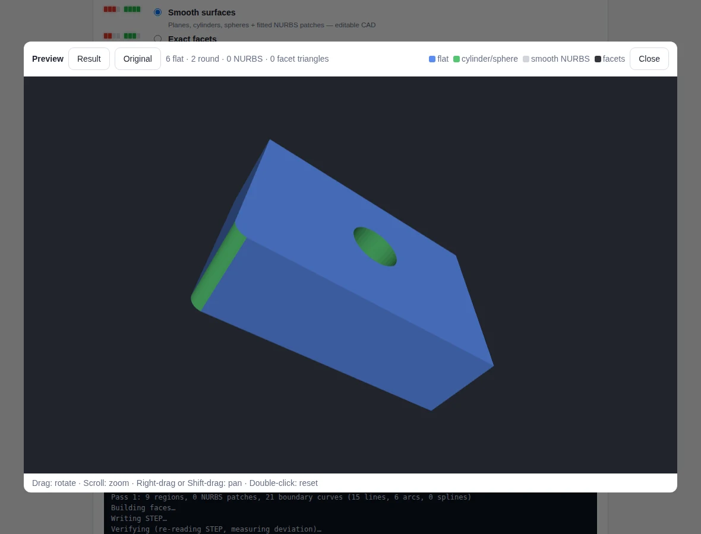
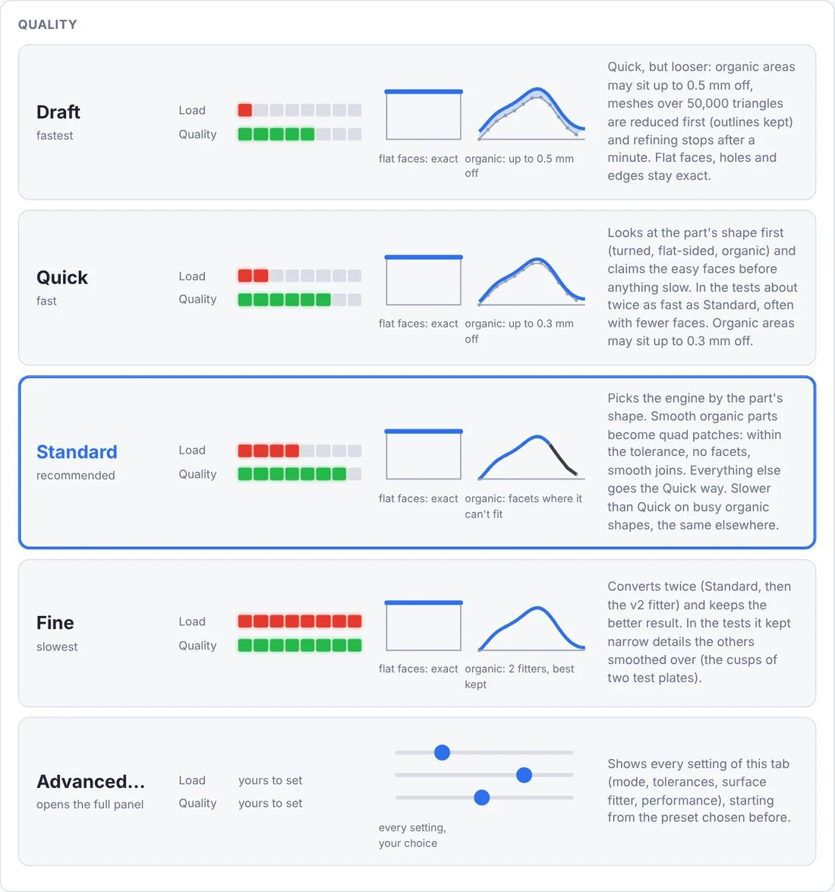
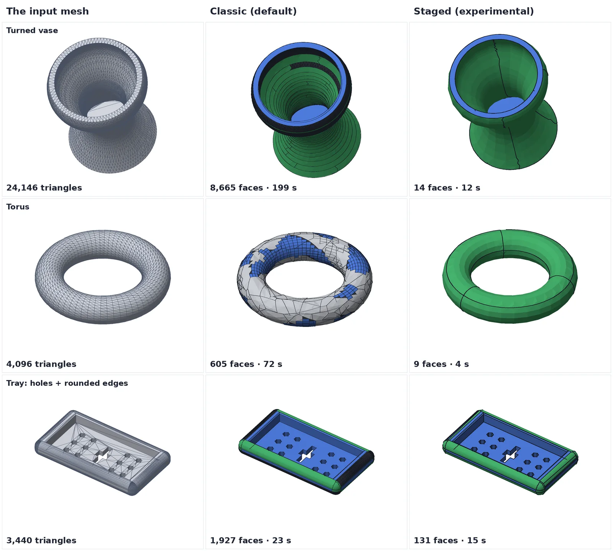
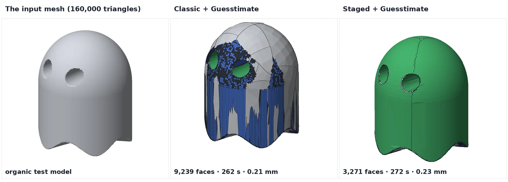

**WORK IN PROGRESS: MANY FEATURES MAY BE BROKEN** (version 0.11.1-wip)

# Twoo STEP CAD Toolbox

*(The name is a play on **to**, **two** and **too**; it stands for the all-in-one approach.)*

**Possibly the most advanced and functional free (for non-commercial use) solid conversion software in the world:** STL meshes, hardpoint STL files, OpenSCAD models and photos of flat parts to real, editable STEP solids, offline, on Linux, macOS and Windows.

*Source-available · Non-commercial* — licensed under the [PolyForm Noncommercial License 1.0.0](LICENSE.md).
Provided **as is, with no warranty and no liability**. Check converted files before relying on them.

> **This is the long-term-support successor of STL2STEP / EVERYTHING to solid.**
> That app (last version 0.10.3, which is 0.10.2 plus the graphics-card fix) is frozen as a finished, dead-end project and stays online for anyone who wants to read it:
> **<https://github.com/The-Dorkknight/stl2step>**. This repository carries all of its history (the full changelog,
> research notes and logs are in [`docs/history`](docs/history) and [`docs/research`](docs/research)) and what comes next.
> The story of the split is in [LEGACY.md](LEGACY.md); what "long-term support" does and does not promise is in
> [LTS_POLICY.md](LTS_POLICY.md).

One portable folder that turns things into **real STEP solids** (true planes, cylinders, spheres and fitted
NURBS, not thousands of triangles). Every tool in it is a **plug-in** with a small manifest; the web page, the
command line, a FreeCAD workbench and a Fusion add-in are all built on the same five.

| Plug-in | What it does | Status |
|---|---|---|
| **Mesh → STEP** (`mesh2step`) | STL / OBJ / PLY / 3MF mesh → STEP solid, with four presets (Draft, Quick, Standard, Fine) and *Advanced…* for every setting. Also *Extrude outline* and *Loft* for flat-profile and tapered parts. | stable core, experimental engines |
| **Hardpoint STL** (`hardpoint`) | Reads an STL that also remembers which CAD face each triangle came from and rebuilds the solid from those faces instead of guessing; or turns a plain STL into one. | stable |
| **OpenSCAD → STEP** (`scad2step`) | Rebuilds an OpenSCAD model as real CAD geometry (true cylinders, spheres, swept surfaces, exact booleans). Customizer fields, preview, live link. | stable |
| **Jetwash** (`jetwash`) | Cleans slivers, 0.0001 mm steps, thin fins, specks and tiny holes out of an existing STEP file; every removal is checked and rolled back if it would damage the part. | stable |
| **Image → STEP** (`image2step`) | Traces a photo, scan or drawing of a flat part into CAD curves and saves a STEP: a solid of the thickness you type, or the flat shape. | **experimental** |

It runs in your web browser from one portable folder; nothing is installed on your system. Mac, Windows and Linux.

### What the different ways of converting look like

Pick a **quality preset** (or *Advanced…* for every setting). Each button shows how hard it works your computer (red)
and how good the result is (green):

The same three meshes converted the normal way (Classic, the original converter) and with **roughing first**
(the Staged way, which the Quick and Standard presets now use for turned and flat-sided parts): far fewer, cleaner
faces, and faster.

An organic test model with *Guesstimate* on: flat faces and holes stay exact, freeform areas are allowed to sit a
little further from the mesh, so it finishes in minutes instead of grinding for hours.

More pictures, and every measurement behind them, are in the research paper
[SOLID evidence](docs/research/SOLID_EVIDENCE.md) ([PDF](docs/research/SOLID_EVIDENCE.pdf)).

**Reporting a problem?** The 3D preview carries a **Diagnostic** panel: the job's settings and result as a QR code and
in plain words. One screenshot of it says it all ([how it works](docs/guide/diagnostic-code.md)).

## Start (install)
| System | Double-click |
|---|---|
| macOS 12+ (Apple Silicon or Intel) | `Twoo STEP CAD Toolbox (Mac).command` |
| Windows 10/11, 64-bit | `Twoo STEP CAD Toolbox (Windows).bat` |
| Linux (x86-64 / 64-bit ARM) | `twoo-step-cad-toolbox-linux.sh` |

Get the zip from the repository's **Releases** page (only the newest four are kept; every older version stays on the **Tags** page).
Unzip it anywhere and double-click the start file for your system. A small window (Terminal / console) opens and your browser shows the app.
**Keep that window open while you work; close it to quit.**

**macOS first time:** macOS blocks scripts from the internet. Right-click the `.command` file → Open → Open. If there is no Open button (macOS 15+), open System Settings → Privacy & Security and click "Open Anyway". After that a normal double-click works.

**Using GitHub Desktop** (no terminal needed): clone the repository, then double-click the start file in the folder GitHub Desktop opened (*Repository → Show in Finder / Explorer*).

### Portable and self-contained
Everything stays inside the folder:

    Twoo-STEP-CAD-Toolbox/
      tostep/     the program (core, plug-ins, front ends)
      launch/     the start script the double-click files call
      runtime/    private Python 3.12 + libraries, one subfolder per CPU type
      Output/     your results (also offered as a browser download)

- The first start downloads **uv** (~20 MB), **Python 3.12** (~30 MB) and the libraries (~500 MB); about 1.5 GB on disk, a few minutes. Later starts are instant.
- It never uses or changes your system Python, Homebrew, conda or anything else. Nothing is written outside the folder.
- **Move or copy the folder anywhere** and it keeps working. **Uninstall:** delete the folder. **Reset:** delete `runtime/`.

## Command line (optional)
Pass arguments to the start file, or run `python run_tostep.py …` with the private Python:

    ./twoo-step-cad-toolbox-linux.sh part.stl                         # → part.step
    ./twoo-step-cad-toolbox-linux.sh convert part.stl out.step --preset quick
    ./twoo-step-cad-toolbox-linux.sh wash old.step --threshold 0.05
    ./twoo-step-cad-toolbox-linux.sh scad model.scad -D width=40
    ./twoo-step-cad-toolbox-linux.sh image photo.jpg --part-above-token 10 --thickness 10
    ./twoo-step-cad-toolbox-linux.sh hardpoints part.stl
    ./twoo-step-cad-toolbox-linux.sh diag screenshot.png
    ./twoo-step-cad-toolbox-linux.sh plugins                          # what is installed, and anything broken

Which commands exist comes from the plug-ins. The classic converter stays the default on the command line and in the CAD plug-ins; new engines are opt-in.
More: [docs/guide/using.md](docs/guide/using.md).

## FreeCAD and Fusion
Open the **Install** tab and click *Install FreeCAD plug-in* or *Install Fusion add-in* (or run `install freecad` / `install fusion`). Both are thin front ends:
they send the mesh to this folder, it converts in the background and the solid comes back into your model. Start the toolbox once first so its setup is done.
Details and manual install: [docs/guide/cad-plugins.md](docs/guide/cad-plugins.md). **Neither has been run in a real FreeCAD or Fusion yet** (see below).

## What to read next
| | |
|---|---|
| [docs/guide](docs/guide) | One page per feature: hardpoints, OpenSCAD, images, engines, performance, troubleshooting |
| [HOW_IT_WORKS.md](HOW_IT_WORKS.md) | The pipeline, step by step |
| [ARCHITECTURE.md](ARCHITECTURE.md) · [docs/PLUGIN_CONTRACT.md](docs/PLUGIN_CONTRACT.md) · [docs/ADDING_A_PLUGIN.md](docs/ADDING_A_PLUGIN.md) | How it is put together, and how to add a tool |
| [MAINTAINING.md](MAINTAINING.md) · [docs/DECISIONS.md](docs/DECISIONS.md) · [LTS_POLICY.md](LTS_POLICY.md) | For whoever looks after it next |
| [docs/KNOWN_LIMITATIONS.md](docs/KNOWN_LIMITATIONS.md) | What has and has not been tested, honestly |
| [docs/research](docs/research) · [SOLID_EVIDENCE](docs/research/SOLID_EVIDENCE.md) | The research notes and the defensive publication of every method |
| [CHANGELOG.md](CHANGELOG.md) · [docs/history](docs/history) | What changed, including the whole STL2STEP history |
| [docs/MIGRATING_FROM_STL2STEP.md](docs/MIGRATING_FROM_STL2STEP.md) | New names for old commands, settings and environment variables |

## Honest status
- **Work in progress.** Expect rough edges. Version 0.11.0-wip moved the whole 0.10.2 app into a plug-in structure *without changing what the converters do*: on the test knob the new layout writes a STEP file of the same size and face count as 0.10.2, and the old test-suite ports pass. The release gate (`tools/golden.py`) is described in [benchmarks/README.md](benchmarks/README.md).
- **Linux is the only tested platform.** The Windows and macOS start files and the FreeCAD and Fusion plug-ins have **not** been run on real Windows, macOS, FreeCAD or Fusion. Version 1.0 is gated on that: [LTS_POLICY.md](LTS_POLICY.md).
- A plain 96-sided cylinder converted with the default Classic engine stays 98 flat strips; Standard and Quick make it 3 true faces. Known, measured and locked in the release gate so it can only get better.
- The result is a solid of surfaces, not an editable feature history (no sketches / extrudes).

## Licence
Copyright Matthew Armstrong. **PolyForm Noncommercial License 1.0.0** — source-available, *not* open source (not OSI-approved); GitHub shows the licence as "Other".
- You may use, modify and share it for **non-commercial** purposes. Anyone you share it with must get the licence and the Required Notice.
- **Commercial use is not allowed** without separate written permission from the author. That includes companies such as Bambu Lab — no permission is granted to them. Permission for other companies (for example Prusa Research) can be requested by opening a GitHub issue; it is at the author's discretion.
- No warranty, no liability. "Non-commercial" has fuzzy edges; if unsure, ask.
- Contributions are accepted under the same licence ([CONTRIBUTING.md](CONTRIBUTING.md)).
- Third-party libraries keep their own licences: [THIRD_PARTY.md](THIRD_PARTY.md).

This is a plain-language summary and not legal advice; the licence text in [LICENSE.md](LICENSE.md) is what counts.

[SECURITY.md](SECURITY.md) · [LEGACY.md](LEGACY.md)
