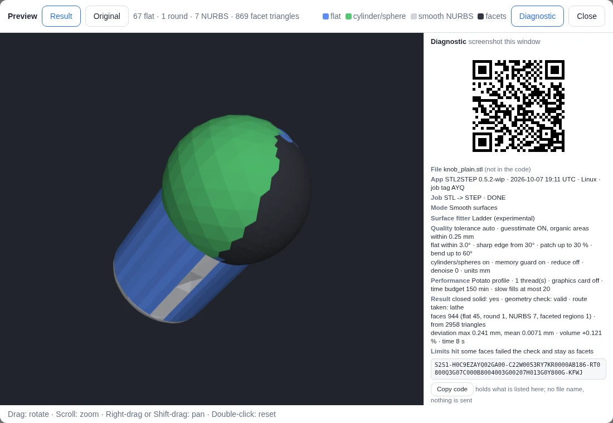

<!-- Required Notice: Copyright Matthew Armstrong (https://github.com/The-Dorkknight) -->
<!-- Licensed under the PolyForm Noncommercial License 1.0.0. No warranty. -->
<!-- Carried over from the STL2STEP / EVERYTHING to solid 0.10.2 README. Where it says 'app/' or 'tab', read the plugin folder under tostep/plugins/. -->

## Diagnostic code: one screenshot says what was set and what came out

*New in 0.5.2-wip.* When a conversion finishes, the 3D preview opens with a **Diagnostic** panel on its right:

- a **QR code** that carries the job's settings and result;
- **the same in plain words**: mode, surface fitter, the quality settings (tolerance, guesstimate, angles, patch
  size, switches), the performance profile with its time budget and fill allowance, then the result: closed solid
  or not, geometry check, route taken, face counts, deviation, volume difference, time, and which limits were hit
  (time budget reached, checkpoint kept, memory tight, faces left as facets ...);
- the **code as text** with a *Copy code* button.

Take **one screenshot of the preview window** and the report is complete: nothing to remember, nothing to copy
from the log. The *Diagnostic* button in the window's bar hides the panel. A job that **failed** has no preview,
so its red result box has a *Show the diagnostic code* button that opens the same panel. A *Smooth surfaces* or
*Exact facets* conversion run from the command line prints its code at the end.

Reading one back, from a screenshot (or a phone photo of the screen) or from the code itself:

    ./twoo-step-cad-toolbox-linux.sh diag screenshot.png
    ./twoo-step-cad-toolbox-linux.sh diag S2S1-H0C9EZAYQ02GA00-C22W0053RY7KR0000AB186-RT0800Q3G07C000B8004003G00207H013G0Y800G-KFWJ

**What is in the code:** the app version, the time to the minute (UTC), a tag for the job, the settings and
numbers listed above, and "Linux / Windows / macOS". **What is not:** the file's name, any path, the log, the
error text, anything else about your computer. The panel shows the file name and an error's text in words and
marks them "(not in the code)". Nothing is sent anywhere: the QR is a picture on the page.

The code follows the conventions of the author's ErrCode project (several records multiplexed into one string,
Crockford base32, the same time stamp and tag) but is its own format, `S2S1`; it does not contain ErrCode's error
dictionary. It carries the settings of **STL → STEP conversions**; Jetwash, SCAD and Image jobs get the header and
the result only, and the panel says so. The QR picture needs the small `segno` package, which the start file adds
on its next start (needs the internet once); without it the words and the code are still shown. Format, sizes and
how far it was tested: [docs/research/DIAGNOSTIC_CODE.md](../research/DIAGNOSTIC_CODE.md). **Tested on Linux in a
headless browser only; a real phone photo of a real screen has not been tried.**
