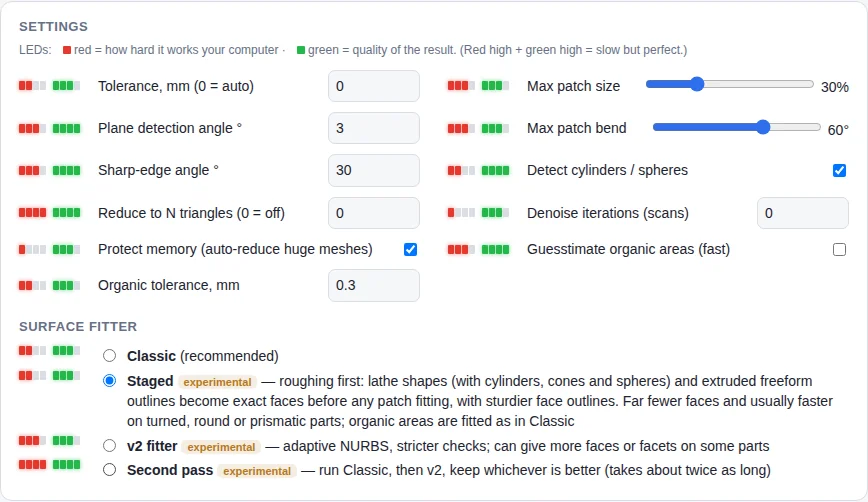
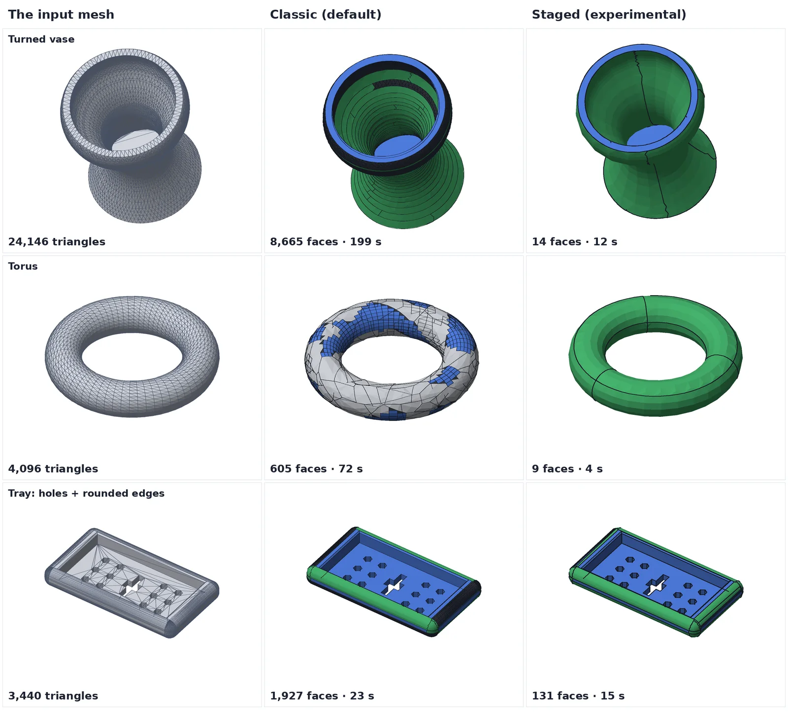

<!-- Required Notice: Copyright Matthew Armstrong (https://github.com/The-Dorkknight) -->
<!-- Licensed under the PolyForm Noncommercial License 1.0.0. No warranty. -->
<!-- Carried over from the STL2STEP / EVERYTHING to solid 0.10.2 README. Where it says 'app/' or 'tab', read the plugin folder under tostep/plugins/. -->

## Staged engine (experimental, off by default)

Choose **Surface fitter → Staged** in Settings (or `--engine staged`) to try *roughing first*. Before any patch fitting, the whole smooth part of the model is searched for **lathe shapes** (one revolve axis, a profile spline) and for **extruded freeform outlines**. Where they fit within tolerance they become single exact faces — a true cylinder, cone or sphere when the profile is straight or circular, otherwise a spline profile revolved or extruded — instead of hundreds of NURBS patches. Everything left over goes through the normal Classic patch fitter. Faces are trimmed directly on their own surface, then the STEP is written, read back, and any face that did not survive is demoted and rebuilt, so the solid stays closed.

It is **opt-in because it is new**: Classic is still the default and its results are unchanged. Guesstimate works with it too (shapes are found on the full mesh, then the mesh is reduced with those regions locked).

Measured (2-core Linux machine, synthetic test parts, default settings):

| Part | Classic | Staged |
|---|---|---|
| Turned vase | 8,665 faces, 199 s | **14 faces**, 12 s |
| Torus | 605 faces, 72 s | **9 faces**, 4 s |
| Fine tray (flats, holes, rounded edges) | 1,927 faces, 23 s | **131 faces**, 15 s |
| Coarse tray | 635 faces | **119 faces** |
| Bracket, sphere, blob | identical | identical |

Max deviation from the mesh was equal or smaller on every one of these. On very dense (about 100,000-triangle) CAD-like test meshes with Guesstimate on, it also finished (vase 191 faces in 38 s, tray 4,080 faces in 3 min, oval-cut plate 1,497 faces in under 2 min, all valid closed solids within 0.14 mm). On a 160,000-triangle organic ghost model with Guesstimate it took 272 s and gave 3,271 faces (Classic with Guesstimate: 262 s, 9,239 faces). **Where it is not better:** the same ghost at full strict tolerance without Guesstimate took 75 minutes, 4.3 GB of memory and ended as an all-triangle solid (Classic: 41 min, 40,484 faces), and a non-watertight 100,000-triangle plate test did not finish in 25 minutes. So: try it on turned, round or prismatic parts, and add Guesstimate for dense organic scans. **Tested on synthetic parts and one organic ghost model only, on a 2-core Linux machine — not yet on a range of real-world parts.** Please try it on yours and compare; `python tools/bench.py part.stl --engines classic staged` prints the same table (faces, share of area as exact shapes, deviation, time, peak memory) for any mesh.

## Ladder engine (experimental, off by default)
*Settings → Surface fitter → Ladder* or `--engine ladder`. Easy things first: the mesh is looked at for a few
milliseconds (its edge-angle histogram, which flats are bounded by sharp edges, whether the curved area is a
surface of revolution about some axis) and routed as **prismatic**, **lathe**, **organic** or **mixed**. Exact
shapes are claimed before anything slow runs, searches that cannot succeed are skipped, and problem areas are
guesstimated (freeform patches within the Guesstimate tolerance, 0.3 mm by default) or kept as facets instead
of being refined for minutes. Classic is untouched and stays the default.

| Part (this 2-core Linux machine) | Classic | Ladder |
|---|---|---|
| Dense lathe vase, 24k triangles | 264 s, 8,980 faces | 8.0 s, 14 faces, max 0.025 mm |
| Organic blob, 10k triangles | 17 s, 20 faces, 0.059 mm | 2.4 s, 20 faces, 0.108 mm (guesstimated) |
| Knob | 11 s, 69 faces, 0.058 mm (0.10.1; 1,103 faces and 0.129 mm before 0.10.0) | 15 s, 69 faces, 0.058 mm (roughing missed, the plain fitter's result kept) |
| Fine stepped shaft with a cross hole | 23 s, 2,190 facets | 1.8 s, 8 faces, 0.007 mm |
| Block with a 15 mm fillet | 20 planes (the fillet as flats) | 9 faces, the fillet a true cylinder |
| Bracket, plate | | same result, same time |
| Coarse tray, fine tray, oval plate, blobs plate (0.10.0: extruded outlines claimed first) | 635 / 1,927 / 141 / 823 faces; 0.24 / 0.08 / 3.7 / 3.0 mm | 119 / 131 / 25 / 121 faces; 0.08 / 0.08 / 0.11 / 0.19 mm; the oval 9 → 28 s (the plain fitter was tried too), the fine tray 14 → 7 s |
| Organic figure, 160k triangles (Potato profile) | Classic + Guesstimate: 262 s, 9,239 faces, 0.21 mm | 318 s, 3,271 faces, 0.26 mm, checkpoint written, peak 1.3 GB |

**Never ending with nothing.** Every performance profile has a time ceiling (Potato 2.5 h, Moderate / Extreme
40 min) after which unfinished areas are kept as exact facets and the file is written; on big meshes a checkpoint
STEP (exact faces, the rest as facets) is written before the slow fitting starts and is kept if the fitter dies,
out of memory included; the slow plate filler is skipped when memory is nearly full; the faceted fallback is
capped at about 20,000 faces so the file stays openable. These apply to Classic too (they only change what happens
to a run that would otherwise go past the ceiling or crash).

Options: `--no-ceiling` switches the time ceiling and fill allowance off (refine for as long as it takes); `--route prismatic|lathe|organic|mixed` forces a route; `--no-ladder-guess` keeps everything at the
tight tolerance (problem areas become facets); `--no-ladder-rough` makes the prismatic route use the plain fitter only (since 0.10.0 it claims extruded outlines first, see below); `--budget 60` turns anything still outside tolerance into facets
once 60 s have passed; `--max-fills 10` limits the slow plate filler; `--plane-rule length` is the flat-border
test the prismatic route uses (usable with Classic too). **Tested on 13 synthetic CAD meshes and two synthetic
organic shapes only, on this machine; not on scans, not on real downloads, not on the target laptops.** The
reasoning and measurements are in [docs/research/](../research/README.md).

## Coons gap filler (experimental, off by default)
*Advanced → Gap filler* or `--gap-fill coons+plate` (also `coons`, `plate`, `off`). When the normal fit misses a
freeform patch, Classic, Staged and Ladder use the slow plate filler. The Coons gap filler builds a four-sided Coons
patch on the patch's own outline (grown outwards a little, so the real outline can trim it), fits its inside to the
mesh and trims it back. *Coons, then plate* keeps whichever is closer. Measured on two test parts (paper D18): within
the tolerance on 14 of 29 hard patches against 6 for the plate filler, but about twice as slow per patch, and whole
parts came out about the same (the blob: 21 faces instead of 26 at the same worst gap; the knob unchanged; an 82,000-triangle figure only got slower, by 165 s). So the
plate filler stays the default. Not tried on real scans.

## Quad patches engine (experimental, off by default)
*Advanced → Surface fitter → Quad patches* or `--engine quad`. For smooth organic parts (figures, blobs, sculpted
shapes). A wireframe first, then surfaces between the wires: the mesh is laid out as quads that follow its
curvature (**QuadriFlow**; Instant Meshes where QuadriFlow is not there), every quad edge becomes a curve on the
mesh, every quad an untrimmed patch fitted to the mesh, and neighbouring patches meet exactly, without creases,
along the curves they share. The layout is made finer until the result is within the tolerance. Parts with flat
faces, sharp edges or a turned shape are handed to Classic (the log says why).

| Organic test shape | Quad patches | Classic |
|---|---|---|
| Organic figure, 162k triangles | 57 faces, 0.010 mm, **7 s** | 19 faces, 0.015 mm, 421 s |
| Bumpy ring with a hole, 9k triangles | 1,787 faces, **0.028 mm (within tolerance), no facets**, 124 s, seams ≤ 3° | 1,044 faces, 0.144 mm, 50 facet areas, 31 s, seams up to 32° |
| Blob, 10k triangles | 492 faces, **0.022 mm (within tolerance)**, 38 s | 24 faces, 0.057 mm (twice the tolerance), 8 s |

QuadriFlow ships for 64-bit Linux with glibc 2.38 or newer (Ubuntu 24.04, Linux Mint 22 and later) in
`tostep/plugins/mesh2step/bin/linux-x86_64/`. Everywhere else the launcher installs **Instant Meshes** once, by itself (since 0.10.2; a
ready-built ~1 MB package for Apple-silicon Macs, 64-bit Windows and 64-bit Linux), and the engine uses that; or run
`python3 tools/build_quadriflow.py` once to build QuadriFlow (needs CMake and a C++ compiler). **Tested on synthetic organic shapes on this
Linux machine only; not on real scans or sculpts, not on Windows or macOS.**
[Notes and every number](../research/QUADPATCHES.md).
