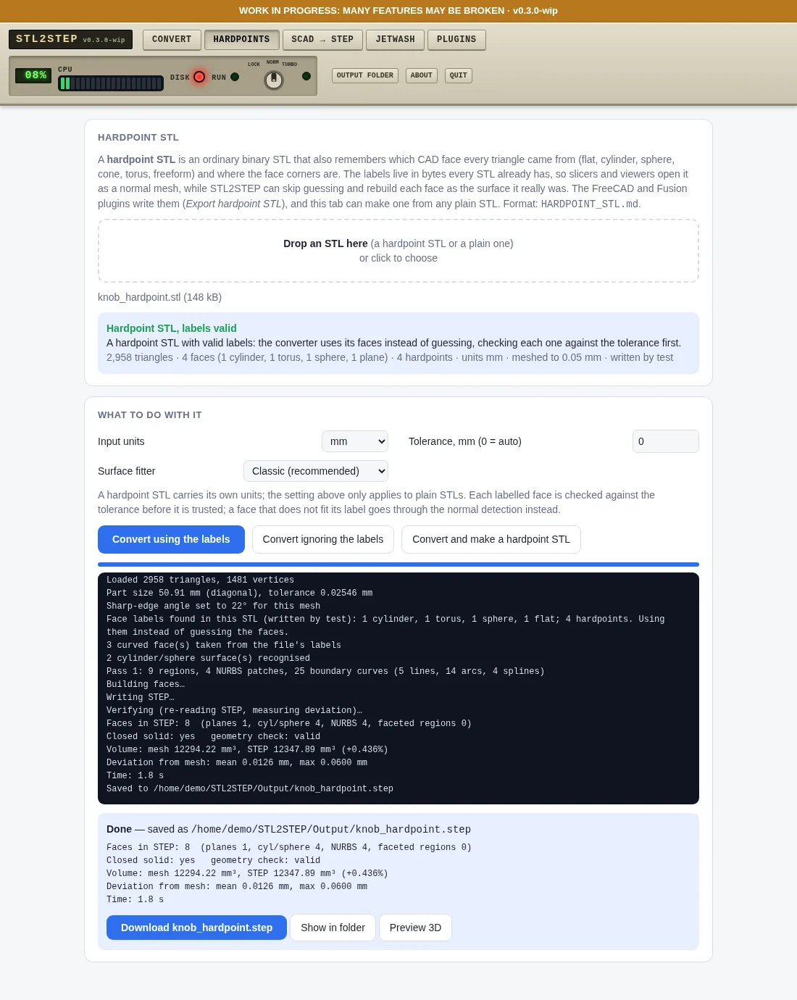
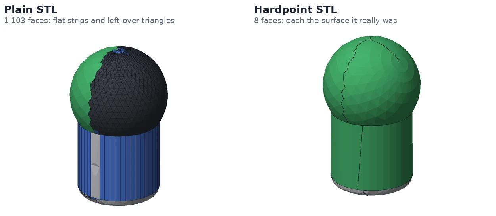

<!-- Required Notice: Copyright Matthew Armstrong (https://github.com/The-Dorkknight) -->
<!-- Licensed under the PolyForm Noncommercial License 1.0.0. No warranty. -->
<!-- Carried over from the STL2STEP / EVERYTHING to solid 0.10.2 README. Where it says 'app/' or 'tab', read the plugin folder under tostep/plugins/. -->

## Hardpoints tab: STL files that remember their CAD faces

A **hardpoint STL** is an ordinary binary STL, same triangles, same file size, same `.stl`
extension, that also records in its spare bytes which CAD face every triangle came from, what
kind of surface that face is (flat, cylinder, sphere, cone, torus, freeform) and where the CAD corners
are. Slicers and viewers open it as a normal mesh. Twoo STEP CAD Toolbox can skip the guessing and rebuild each
face as the surface it really was. The format is described in [HARDPOINT_STL.md](../../HARDPOINT_STL.md).

- **Drop an STL** and the tab says what it is: a hardpoint STL with valid labels (with its faces,
  units and tolerance), one whose triangles were edited after labelling (the labels are then ignored),
  or a plain STL.
- **Convert using the labels** rebuilds the solid from the faces in the file. Every labelled face is
  checked against the tolerance before it is trusted; a face that doesn't fit its label goes through
  the normal detection instead, so a wrong label can cost speed but not correctness.
- **Convert ignoring the labels** does the same file the normal way, to compare.
- **Convert and make a hardpoint STL** converts a plain STL and also writes the same mesh back out as a
  hardpoint STL carrying the faces it found (the triangles are copied byte for byte), so the next
  conversion of that file is faster and cleaner.
- The FreeCAD and Fusion plug-ins have an **Export hardpoint STL** command that writes the real CAD
  faces straight from your model.

On the test knob (a cylinder, a torus blend and a ball) the plain STL gives 1,103 faces (max deviation
0.129 mm) and the hardpoint STL gives 8 faces (0.060 mm). A bracket gives 21 faces plain and 17 with labels.
Command line: `python run_tostep.py hardpoints part.stl` shows what a file contains, `--no-labels` ignores
them, and `--save-labelled` also writes the hardpoint STL. Labels are only used on the full mesh, not on one that
was reduced first. **Tested on four small sample files and nothing else; cones and tori become fitted NURBS
faces, not true cone and torus surfaces.**
