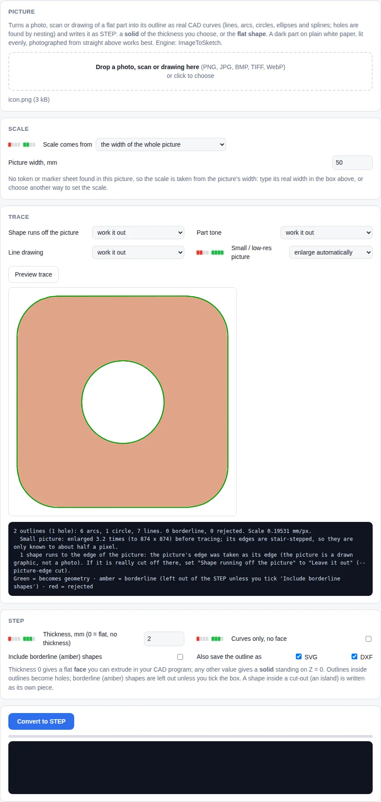
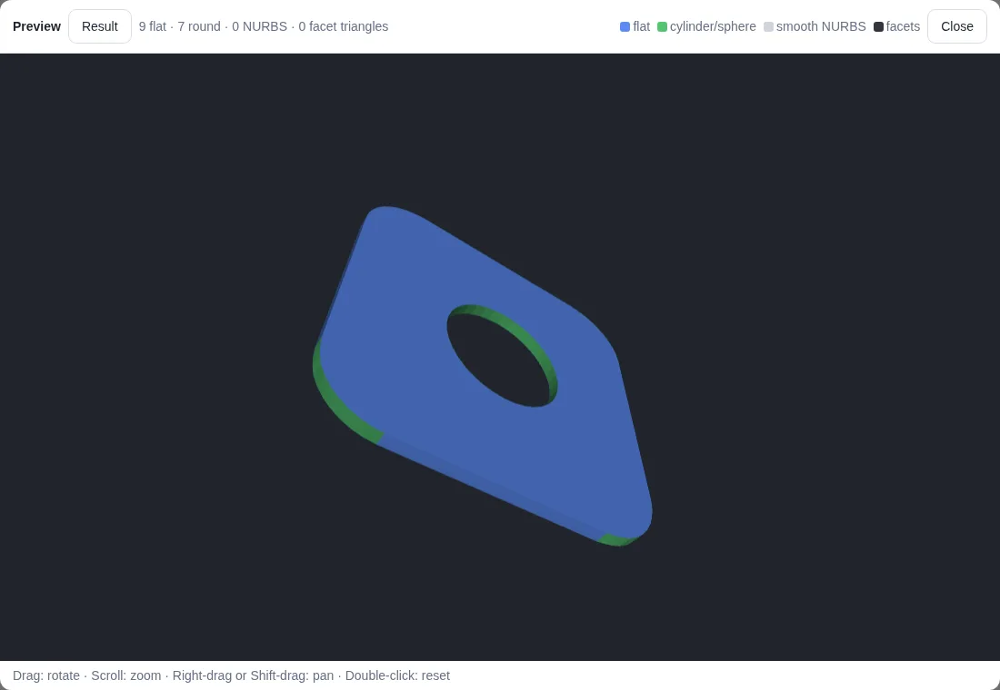
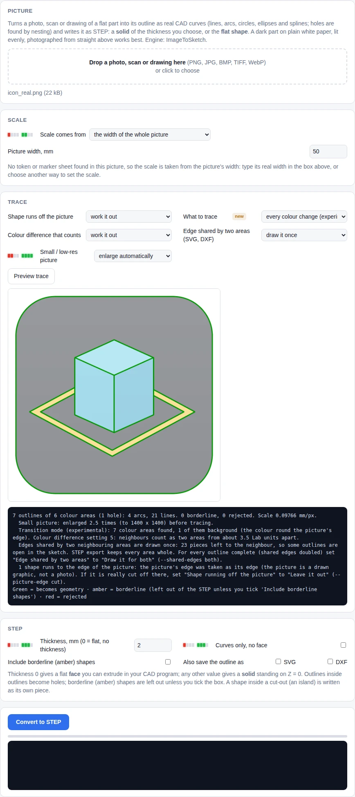

<!-- Required Notice: Copyright Matthew Armstrong (https://github.com/The-Dorkknight) -->
<!-- Licensed under the PolyForm Noncommercial License 1.0.0. No warranty. -->
<!-- Carried over from the STL2STEP / EVERYTHING to solid 0.10.2 README. Where it says 'app/' or 'tab', read the plugin folder under tostep/plugins/. -->

## Image → STEP tab: a photo, scan or drawing as a STEP outline

Drop a picture of a flat part (PNG, JPG, BMP, TIFF, WebP). Its outline is traced into the fewest lines, arcs,
circles, ellipses and splines that fit, outlines inside outlines become holes, and the result is written as STEP in
millimetres. The engine is the **ImageToSketch** project (a FreeCAD add-in by the same author); the parts of it that
need no FreeCAD are built into `tostep/plugins/image2step/imagetosketch` (this build carries ImageToSketch 0.10.1).

1. **Picture.** A dark part on plain white paper, lit evenly, photographed from above works best. Scans and clean
   drawings work too (a line drawing is traced along the middle of its lines). The preview shows what will be kept:
   green becomes geometry, amber is borderline and left out, red is rejected.
2. **Scale.** The tab looks at the picture and picks what it finds:
   - **Calibration sheet** (new in 0.9.2-wip, ImageToSketch 0.10.0; now the first choice in the list): download
     the sheet (PDF, A4 or Letter, 2 pages) and print both pages at 100 %. Page 1 is a frame of 40 numbered
     markers round a clear middle: lay it flat and put the part in the middle. It gives the scale, the camera's
     tilt (from 160 marker corners), the lens's slight bend (taken out), a warning when the paper is not flat, and
     how the light falls; markers hidden by a shadow or the part are left out. Download and print the **50 mm
     stand** too (STL, top face down, no supports), glue a label from page 2 on its top, measure its height with
     calipers and type it once (*Stand height, measured*). Stood inside the frame a few cm from the part, its
     marker is 50 mm nearer the camera than the frame's, so it **measures the camera distance**: no lens data
     needed and nothing to type but the part's height. Page 2's two check lines (150 and 200 mm) put right a
     printer that stretches the page: measure them once and type what they measure. These three numbers are
     remembered by the browser. On simulated photos of a 140 mm tall part (only its height typed), ImageToSketch
     measured within 0.7 % from 30 - 45 cm and 0.6 % from about 1 m, where the token sheet was out by up to 40 %.
     **Not tried yet on a real print, a real stand or a real photo.** [Notes](../research/CALSHEET.md).
   - **Empty-sheet photo** (optional, with the calibration sheet; ImageToSketch 0.10.1): take the part away (the
     stand can stay), photograph the sheet again from about the same place and give that photo with the button
     under the picture. The two photos are lined up through the frame's markers; what did not change (the
     printer's banding, dust) and the part's shadow are made plain paper before tracing. On ImageToSketch's
     simulated photos of a 140 mm part with a long hard shadow: within 0.8 % / 3 % instead of 6.6 % / 7.8 %, and
     no borderline shadow outline. A part as grey as its shadow, with no texture of its own, cannot be told from
     it (the message says so).
   - **Scale token**: a black square (40 mm) with one clipped and one rounded corner. *Printed on paper*: download
     the **token sheet** (PDF, A4 or Letter; a token in two opposite corners), print it at 100 %, measure a square
     with a ruler and type what you measure, lay the part on the sheet. One token gives the scale; with both in
     view the camera's tilt is measured across the whole sheet. *3D-printed plastic*: download the STL
     (40 x 40 x 1.2 mm), print it in matt black, lay it on white paper beside the part. Either way a photo taken
     a little off vertical is straightened.
   - **Part's top above the token**: something nearer the camera looks bigger (a 10 mm part from 300 mm: about
     3 %). Type the part's height here and that is taken out. It needs the camera distance, which a phone or camera
     JPEG carries in its lens data (0.9.1: the lens data now comes first, and a typed distance is only compared
     with it); for a PNG, a screenshot or an edited photo, type *Camera distance*. A distance that is only roughly
     right just scales the outline evenly (from 1 m, 10 % out costs about 1.6 % on a 140 mm tall part); with
     neither, a phone's main camera is assumed. The side-wall correction is skipped, with a message, when the
     camera's position is too uncertain. Send photos of tall parts straight from the phone, not through a
     messenger (it strips the lens data). *Part's top above the token*, *Camera distance* and *Part has straight
     vertical sides* now sit just above *Convert to STEP*.
   - **Marker sheet** (four printed markers around the part), **the file's own resolution** (flatbed scans),
     the picture's width, millimetres per pixel, or a plain square of known size.
3. **STEP.** *Thickness*: 0 writes the **flat shape** as a face, any other value a **solid** of that thickness
   standing on Z = 0. A STEP file does not have to contain a solid, so there is no need to extrude by a dummy 1 mm
   just to be able to save: the file then holds a surface, which you can extrude in your CAD program. *Curves
   only* writes just the lines and arcs with no face; that is valid STEP too, but some programs skip bare curves
   when importing (Fusion's STEP import reads faces and solids), so the face is the safer flat form.
   *Include borderline shapes* adds the amber ones the tracer was unsure of. *Also save the outline as SVG / DXF*
   writes the same outline as a millimetre drawing into `Output/` beside the STEP, for laser cutters and 2D CAD.
4. **A shape that fills the picture.** A logo or icon often runs right to the picture's edge. *Shape runs off the
   picture → work it out* continues drawn graphics a little beyond the edge so the whole shape is traced, and
   leaves photos alone; the other two choices force it either way. (Before 0.5.1 such a shape was left out and only
   what was inside it was written.)
5. **Convert to STEP.** The result opens in the same 3D preview as the other tabs.

### Every colour change (experimental, new in 0.5.2-wip; neighbours meet exactly since 0.7.0-wip)

Normally the part is traced **against its background**: one outline per part, plus its holes. A picture with
several colours has more edges than that. On an app icon (a grey rounded square, a cube drawn in three shades of
blue, a yellow ring) the ordinary trace outlines the square and the light blob standing in it, and nothing says
where the cube ends and the ring begins, or where one face of the cube meets the next. Set **What to trace** to
**every colour change** and:

- **every colour area gets its own outline**, and in the STEP **its own face or solid**: the pieces lie side by
  side like a jigsaw (the icon above: 6 solids, each within 0.1 % of its true area on the test redrawing);
- **a smooth blend is not an edge**: a gradient, a soft drop shadow or light falling off across a table gives no
  line;
- neighbours may shade: two faces with a light-to-dark gradient are told apart even where their colours overlap;
- the colour round the picture's edge is the background, and the same colour seen through a hole is a hole;
- *Colour difference that counts* sets how different two colours must be (left to work it out, it is cautious
  with noisy photos and JPEGs); *Edge shared by two areas* only matters for the SVG / DXF copies.

Tracing the ordinary way, a clean picture with three or more flat colours gets a line in the log saying that this
mode exists. It is 2 to 4 times slower than the ordinary trace and works on pictures up to 1600 px a side (larger
ones are reduced first). **It has only been tried on pictures drawn by the test code**, among them a redrawing of
the icon it was reported with, made from a photograph of a screen: not that icon's file, no real logo, no real
photograph. Known limits: drawn outlines between areas (each area is traced to the inside of the line), the same
colour on both sides of a thin line (one area), greys closer than about 10 levels, pictures under about 96 px,
blur over about 2 px. What was tried and dropped, the numbers and the limits:
[docs/research/TRANSITION_TRACING.md](../research/TRANSITION_TRACING.md).

To try it without printing anything: `examples/plate-on-token-sheet-simulated.jpg` is a **simulated** photo (it carries
lens data like a phone photo) of a 90 x 60 x 10 mm plate with a 16 mm bore on the token sheet. Drop it in, type 10
under *Part's top above the token* and 10 under *Thickness*.

Command line: `python run_tostep.py image photo.jpg --part-above-token 10 --thickness 10`, `--markers`, `--dpi`,
`--mm-per-px 0.1`, `--picture-edge edge`, `--include-borderline`, `--also-svg`, `--also-dxf`,
`--find transitions` (with `--colour-step`, `--shared-edges`), `--make-token-sheet sheet.pdf`,
`--make-token token.stl` (`image --help` lists the rest).

**How far this has been tested:** on pictures drawn by the test code and on photographs made by a simulated camera,
where the true sizes are known (plate sides within about 0.2 % with the part's height typed in; without the camera
distance a 10 mm part reads 2 - 4 % large, and the log says so). **No token has been printed and no real photo
traced.** Lens distortion is not corrected. Details and the accuracy table are in the ImageToSketch repository.

The mesh side already had its own depth setting: in **STL → STEP → Advanced… → Extrude outline**, *Extrude height* (0 = the part's
own height; `--height` on the command line) sets how deep a traced mesh outline is extruded.

**Neighbours meet exactly** (on by default, new with ImageToSketch 0.9.0): where two colour areas touch, both use
one and the same curve for the edge they share, so the faces or solids fit together with no gap and no overlap. Untick
it (command line `--no-weld`) to let each area keep its own fit of the edge, as in 0.5.2.
