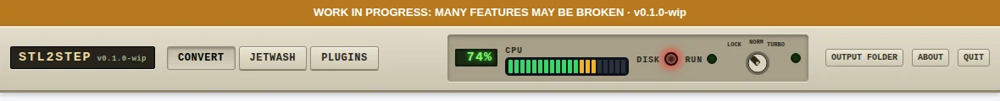
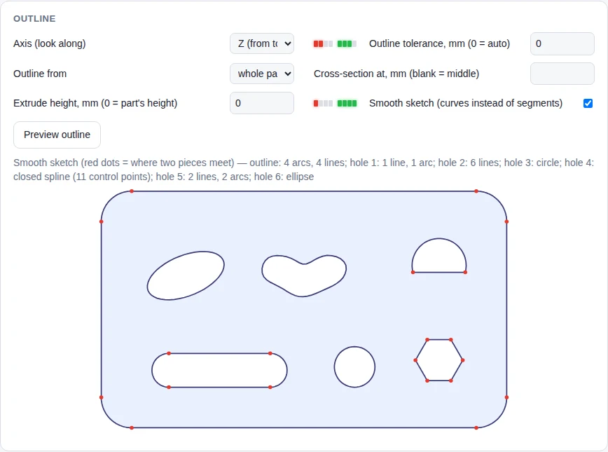
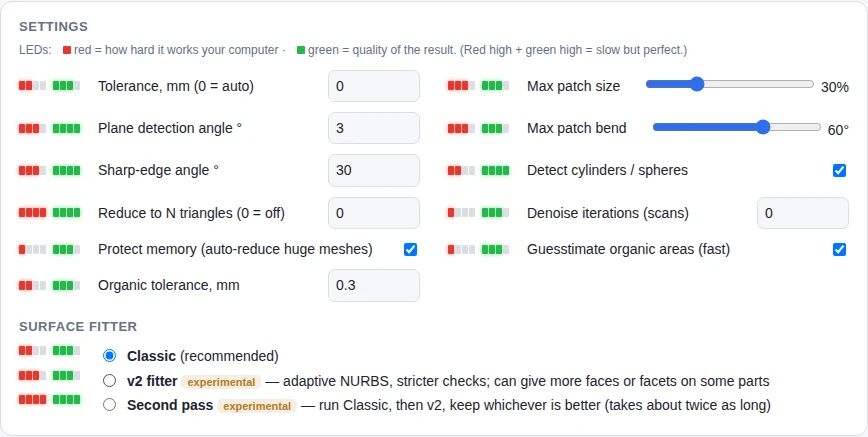
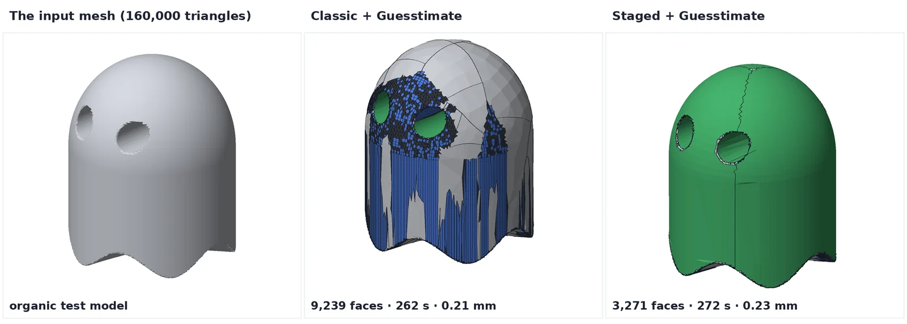

<!-- Required Notice: Copyright Matthew Armstrong (https://github.com/The-Dorkknight) -->
<!-- Licensed under the PolyForm Noncommercial License 1.0.0. No warranty. -->
<!-- Carried over from the STL2STEP / EVERYTHING to solid 0.10.2 README. Where it says 'app/' or 'tab', read the plugin folder under tostep/plugins/. -->

## Front panel, activity LEDs and effort LEDs

The top bar is styled like an 80s/90s PC case. Left to right: tabs, a CPU % display and VU bar, a red **DISK** LED, a green **RUN** heartbeat that blinks every second while a job is running (amber if it has been quiet for 45 s), and a 3-position **LOCK / NORM / TURBO** key switch that is purely decorative for now.

Every setting has two little LED stacks: **red = how hard it works your computer**, **green = quality of the result**. Red high + green high means the computer will drag but the output will be as good as it gets. They are rough guides computed from the value, not measurements, and update as you change a setting.

## Smooth sketch (optional, in Extrude outline mode)

*Extrude outline* normally redraws a part's outline as straight segments, so an oval hole becomes dozens of tiny flats. Tick **Smooth sketch** and each loop is redrawn as the simplest shapes that stay within the outline tolerance: straight **lines**, true **arcs** and **circles**, **ellipses**, and **splines** with as few control points as possible. Press *Preview outline* to see it; red dots mark where two pieces meet. Command line: `--mode extrude --smooth-sketch`.

On a test plate with rounded corners, a slot, a D-shaped hole, a hex hole, a round hole, an ellipse and a freeform "bean" hole, the result has 25 faces, the same as the original CAD model (94 without Smooth sketch at the automatic tolerance, 319 at 0.02 mm). The ellipse comes back as one true ellipse and the bean as one closed spline (11 control points at the automatic tolerance, 33 at 0.02 mm).

Limits: it only applies to *Extrude outline* (not Loft, not Smooth surfaces). A loop that can't be fitted within tolerance stays as straight segments, and the log says so. Noisy or scanned outlines come out in more pieces. A very coarse round fillet (steps over 25°) is read as corners. The plug-ins don't offer it yet.

## Guesstimate organic areas (optional, off by default)

Tick **Guesstimate organic areas (fast)** in Settings when the freeform parts of a model only need to be roughly right. *Organic tolerance* (default 0.3 mm) is how far a freeform surface may sit from the mesh inside a patch. **Flat faces, round holes (cylinders), spheres and all edges keep the normal tight tolerance.** With it on, dense meshes are first reduced (staying within a third of the normal tolerance, checked, and kept closed) and the slow patch filler is skipped. Command line: `--guess` or `--guess 0.3`. Works with the Classic and Staged fitters; the FreeCAD and Fusion plug-ins don't offer it yet.

Measured on a 160,000-triangle organic test model (2-core machine): 41 min → 4.3 min, 107 MB → 28 MB STEP, 40,484 → 9,239 faces, max deviation 0.105 → 0.211 mm. It does **not** reduce the number of areas left as triangles (513 vs 450 regions); that needs the boundary work planned next. Parts made only of flats and round features come out identical with it on or off.
