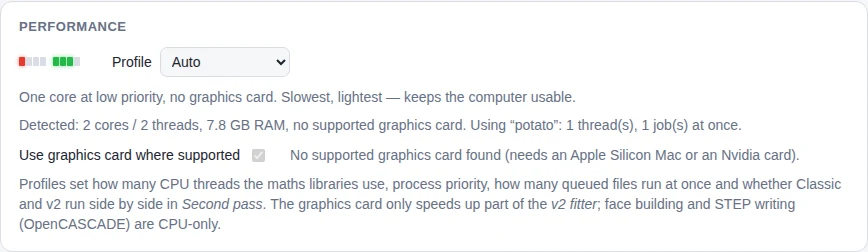
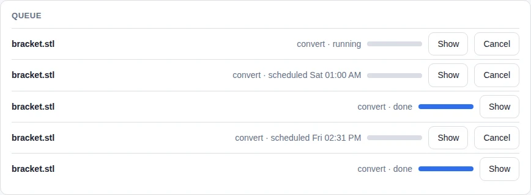
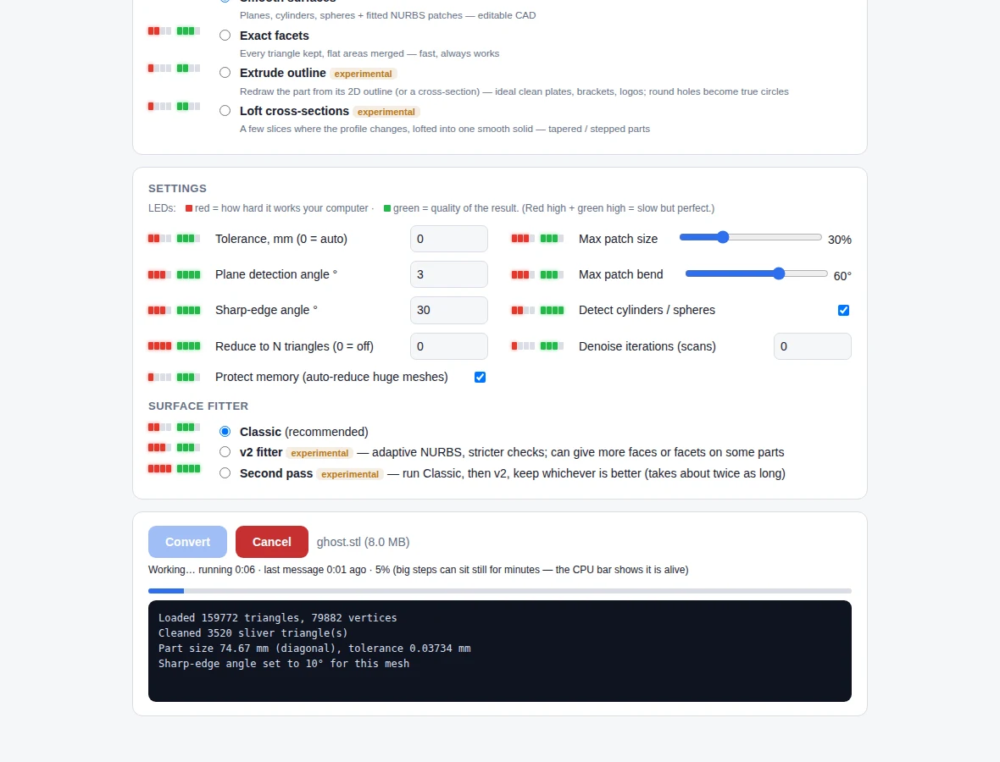

<!-- Required Notice: Copyright Matthew Armstrong (https://github.com/The-Dorkknight) -->
<!-- Licensed under the PolyForm Noncommercial License 1.0.0. No warranty. -->
<!-- Carried over from the STL2STEP / EVERYTHING to solid 0.10.2 README. Where it says 'app/' or 'tab', read the plugin folder under tostep/plugins/. -->

## Performance profiles, GPU, queue and scheduling

Pick a **profile** in the Performance card (or leave it on *Auto*, which looks at your cores and RAM):

| Profile | For | What it does |
|---|---|---|
| **Potato** | old or small laptops (e.g. 8 GB RAM, 4 cores) | 1 thread, low priority, no GPU, meshes over 30,000 triangles reduced first (features kept). Slowest, lightest. |
| **Moderate** | typical modern laptops | about half the threads, GPU where supported. |
| **Extreme** | Apple Silicon Macs, workstations | every thread, Classic and v2 run side by side in *Second pass*, several queued files at once, GPU where supported. |

Command line: `--profile potato|moderate|extreme|auto` (and `--no-gpu`).

**Graphics card (optional, experimental).** Only the *v2 fitter's* shape scoring (the **Fine** preset and *Second pass*) can use a graphics card; everything else, including Quick and Standard, runs on the processor. The **Graphics card** box on the Convert tab lists every card, says what each needs and installs the right PyTorch build for it (Apple Metal, Nvidia CUDA; GTX 10-series cards need a special older build). Details, what is and is not supported, and why: [gpu.md](gpu.md).

**Queue and scheduling.** Click *Convert* more than once (same file with different settings, or other files) and the jobs line up in a **Queue** card; the profile decides how many run at once. *Start* next to the Convert button can delay a job: in 1 or 3 hours, tonight at 01:00, or at a time you choose. The app stays open and keeps the computer awake while it waits; if you close the app, scheduled jobs are lost.

## Cancel and activity monitor
While a job runs, **Cancel** stops it (the work is in a separate process that is killed) and resets the tab so you can drop a new file. The header shows a **CPU** VU bar and a big red **DISK** LED that lights on disk activity; under the progress bar you see the running time and how long since the last message. Long steps can leave the percentage still for minutes — if the CPU bar is busy, it is working. (Twoo STEP CAD Toolbox uses the CPU only, so there is no GPU meter.)

## Big meshes and slower computers
Speed only affects how long a job takes; running out of memory is what can crash it.
Measured peak memory:

| Triangles | Smooth surfaces | Exact facets |
|---|---|---|
| 10,000 | 0.4 GB, 5 s | 0.55 GB, 12 s |
| 40,000 | 0.5 GB, 20 s | 1.0 GB, 1–2 min |
| 160,000 | 0.9 GB, 30 s | 2.2 GB, 9 min |

**Reducing big meshes keeps features.** "Reduce to N triangles" (and the memory guard below)
first finds flat faces, holes, cylinders, spheres and sharp edges on the full mesh, then
simplifies only inside each region with its outline locked. Flat faces are rebuilt from their
outline alone, round features stay on their exact cylinder/sphere, so a 60-sided hole is
still recognised as one true cylinder afterwards. Example, a 224,000-triangle plate reduced to
22,000: 12 exact faces (0.005 mm), where blind reduction gave 44 fragments and 5 mm of damage.

"Protect memory" (on by default) checks this computer's free RAM before starting and reduces
meshes that wouldn't fit. On an 8 GB laptop that's above ~190,000 triangles in Exact facets
mode or ~775,000 in Smooth surfaces mode. The log says when this happens. While a job
runs, the app works at low priority, so the computer stays usable, and stops it from
idle-sleeping, so an hour-long job isn't interrupted.
