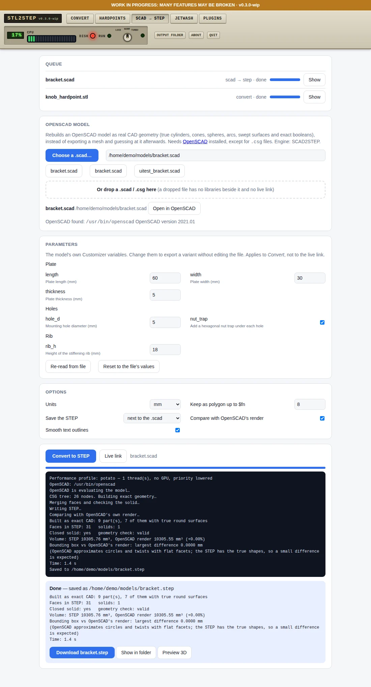
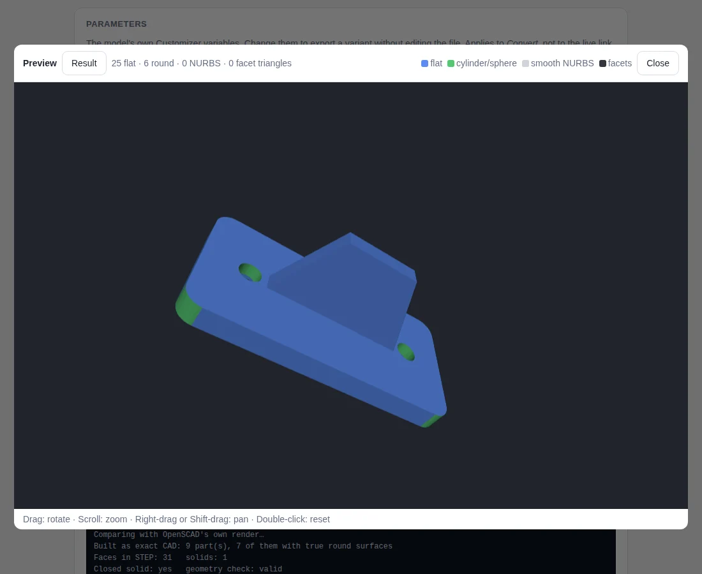

<!-- Required Notice: Copyright Matthew Armstrong (https://github.com/The-Dorkknight) -->
<!-- Licensed under the PolyForm Noncommercial License 1.0.0. No warranty. -->
<!-- Carried over from the STL2STEP / EVERYTHING to solid 0.10.2 README. Where it says 'app/' or 'tab', read the plugin folder under tostep/plugins/. -->

## SCAD → STEP tab: OpenSCAD models as real CAD

Turns an OpenSCAD model (`.scad`, or a `.csg` export) into a solid STEP file with true geometry: cubes become
boxes, cylinders true cylinders and cones, spheres true spheres, extrusions and revolutions true swept
surfaces, booleans exact solid booleans. A low `$fn` on purpose (a `$fn=6` nut trap) stays the polygon it is.
`hull()` and `minkowski()` of common shapes are built exactly too; text and imported 2D outlines come in as exact
outlines; the rare parts with no exact CAD form (an imported STL, `surface()`) are rendered by OpenSCAD and joined
in as flat facets. The engine is the **SCAD2STEP** project, now built into this app.

1. **Choose a .scad…** (or paste its path, or drop it on the page). Choosing from disk keeps `include` / `use`
   libraries next to the file working and lets the live link watch it.
2. **Parameters:** the model's own Customizer variables appear as fields (ranges, drop-downs and `/* [Groups] */`
   are respected), so you can export a variant without editing the file.
3. **Options:** units, which circles stay polygons, where the STEP goes (next to the `.scad`, or `Output/`), a
   comparison with OpenSCAD's own render (volume and size), and smooth text outlines.
4. **Convert to STEP.** The result opens in the same 3D preview as the STL → STEP tab.
5. **Live link:** keep editing in OpenSCAD; each time you save (F2) the STEP beside the `.scad` is rebuilt within a
   second or two (including when a library it uses changes).

You need [OpenSCAD](https://openscad.org) installed (2021.01 or newer; only 2021.01 was tried) unless you only convert `.csg`
files. The app looks for it in the usual places (normal install, AppImage in your home, Downloads or Applications
folder, Flatpak, Snap); otherwise enter its location on the tab. OpenSCAD is not bundled and keeps its own licence.
On the example bracket the STEP has 31 faces and its volume is within 0.002 % of OpenSCAD's render.
Command line: `python run_tostep.py scad model.scad -D width=40`, `--watch` for the live link, `--no-verify`.
Right-click entries (Linux Mint Nemo, GNOME Files, Windows Send to) and FreeCAD / Fusion *OpenSCAD → STEP solid* commands
come from the Install tab.
