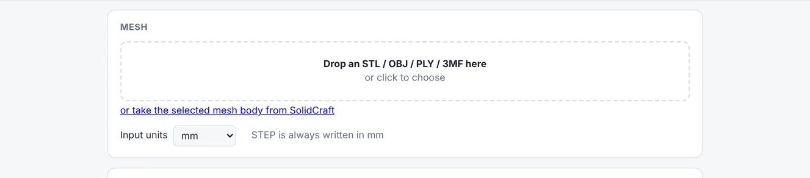
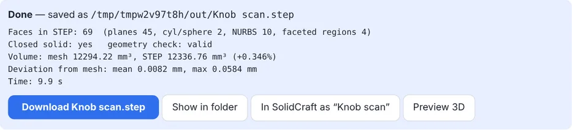

<!-- Required Notice: Copyright Matthew Armstrong (https://github.com/The-Dorkknight) -->
<!-- Licensed under the PolyForm Noncommercial License 1.0.0. No warranty. -->

# SolidCraft link (experimental, new 10 November 2026)

[SolidCraft](https://github.com/tangency-labs/solidcraft) is a free, open-source (MIT / Apache-2.0) parametric
CAD app in the style of Fusion, written in Rust. The toolbox can take a **mesh body** out of a running
SolidCraft, turn it into a proper solid and **put the solid back** as a new component, or send any STEP the
toolbox made straight into it.

> **WORK IN PROGRESS.** Written from SolidCraft's published documentation and tested against a stand-in that
> follows it (`tests/test_solidcraft.py`). It has **not yet been run against a real SolidCraft**. If it
> doesn't connect, `tostep solidcraft --status` says why.

## Turn it on in SolidCraft (once)

SolidCraft has no plug-in system yet (its plug-in design, RFC 0002, is a draft and nothing runs). What it does
have is a **control channel** on your own computer, the same one its AI-agent (MCP) support uses. The toolbox
talks to that.

In SolidCraft: **Preferences › Assistant › Agents through MCP › Let AI agents connect**. It listens on this
computer only (port 27878 by default), and every connection must show a password-like token that SolidCraft
makes fresh each time it starts and keeps in a file only your user account can read. The toolbox reads that
file itself; there is nothing to copy or paste.

## In the app

1. In SolidCraft, select the mesh body (an imported STL or scan).
2. In the toolbox's **Mesh → STEP** tab, click **or take the selected mesh body from SolidCraft**. SolidCraft
   writes the body as an STL and it appears as the chosen file.
3. Convert as usual (any preset).
4. Click **Send to SolidCraft** in the result. The solid arrives as a new component; the mesh body is left as it
   was, so you can compare and then hide or delete it.

*(Screenshots taken against the stand-in SolidCraft of the tests: a real run is still to do.)*

**Send to SolidCraft** is on every result that is a STEP file, so OpenSCAD, Image and Jetwash results can go
across too.

## On the command line

    tostep solidcraft                      # every selected mesh body: export, convert, insert "<name> solid"
    tostep solidcraft --body "Knob scan"   # one body by name (repeat --body for more)
    tostep solidcraft --file part.stl      # convert a file here and insert the solid
    tostep solidcraft --status             # is SolidCraft listening, and if not, why
    tostep solidcraft --preset quick       # draft | quick | standard (default) | fine

Any other option is passed on to `tostep convert` (for example `--guess 0.3`). `--keep FOLDER` keeps the STL
and STEP files. Each conversion runs in its own process with a "still converting" line every 30 s of silence, so
a slow computer shows it is alive and a crash can't take SolidCraft down with it.

## What it uses

Only three SolidCraft commands, all documented: `selection.get` (reads which bodies are selected; changes
nothing), `file.export_stl` (writes one body as STL) and `file.insert_step` (adds the solid as a new component,
undoable like any import). Port and token come from SolidCraft's own files (`current.port`, `PORT.token`) in:

| System | Folder |
|---|---|
| Linux | `~/.local/share/solidcraft/control/` |
| macOS | `~/Library/Application Support/SolidCraft/control/` |
| Windows | `%LOCALAPPDATA%\SolidCraft\control\` |

`SOLIDCRAFT_CONTROL_PORT`, `SOLIDCRAFT_CONTROL_TOKEN` and `SOLIDCRAFT_CONTROL_DIR` override them, as they do
for SolidCraft's own tools; `--port` and `--token` do the same on the command line.

## Why it is a link and not a plug-in inside SolidCraft

See [the research note](../research/SOLIDCRAFT.md). In short: SolidCraft's plug-in runtime doesn't exist yet,
and SolidCraft does not accept LGPL code such as OpenCASCADE (which this toolbox's converter is built on) into
its own source. A separate program talking over its control channel keeps both projects' licences apart and
works today.

## Things that may need fixing on the first real run

- Whether `selection.get` reports a selected mesh body with `type: "body"` (the docs say items come "as
  `select.set` takes them"; face and edge items also name their body, so only whole-body items are taken).
- Whether SolidCraft's own STEP reader takes every face the toolbox writes. Its docs list planes, cylinders,
  cones, spheres, tori, B-spline and trimmed surfaces and surface/seam curves, which is what the toolbox
  writes; offset surfaces (which the toolbox does not write) are not read yet.
- SolidCraft's own **Convert Mesh** (`mesh.convert`) turns a mesh into flat faces and cylinders from runs of
  facets; the toolbox adds lathe and extrusion roughing, NURBS and quad-patch surfaces for organic shapes.
  Which is better on a given part is worth comparing.
