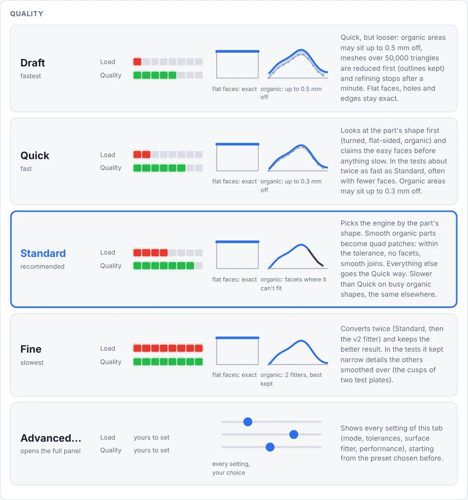

<!-- Required Notice: Copyright Matthew Armstrong (https://github.com/The-Dorkknight) -->
<!-- Licensed under the PolyForm Noncommercial License 1.0.0. No warranty. -->
<!-- Carried over from the STL2STEP / EVERYTHING to solid 0.10.2 README. Where it says 'app/' or 'tab', read the plugin folder under tostep/plugins/. -->

## Using it
**STL → STEP:** drop a mesh, pick the input units (mm / inches / cm / m) and a **quality preset**:

| Preset | What it does | On the 12 test meshes (2-core laptop) |
|---|---|---|
| **Draft** | Quick, looser: organic areas up to 0.5 mm off, meshes over 50,000 triangles reduced first, refining stops after a minute | 158 s in all; as fast as Quick on these, less exact on organic areas |
| **Quick** | The Ladder engine: looks at the part's shape first and claims the easy faces before anything slow; organic areas up to 0.3 mm off | 140 s in all, 1,922 faces (0.10.2 run) |
| **Standard** | Since 0.10.2 the part's shape picks the engine (*Auto*): smooth organic parts become quad patches, within the tight tolerance and with no facets; everything else goes the Quick way | 176 s in all, 2,394 faces; on 5 organic shapes the only preset with all 5 within the tight tolerance and no facets |
| **Fine** | Converts twice (Standard, then the v2 fitter) and keeps the better one | slowest; kept the narrow cusps of the blob plates the others smooth over |
| **Advanced…** | Shows every setting below, starting from the preset you chose | |

Each button shows the same red / green LEDs as the settings (load on your computer, quality of the result) and
a small drawing of what it does to flat faces and to organic areas. Command line: `--preset draft|quick|standard|fine`
(any other option still overrides it). How they were chosen, with every measurement: [PRESETS.md](../research/PRESETS.md);
why Standard changed in 0.10.2 (the old Standard, Classic, was the same or worse than Quick on nearly every test part, and
took 4 to 10 minutes on a real organic model where Quick took 81 s): [STANDARD.md](../research/STANDARD.md). The old
Standard is still there as *Advanced → Surface fitter → Classic*.

**Advanced…** opens the full panel: the mode, every setting, the surface fitter and the performance profile. Modes:
- *Smooth surfaces*: planes, cylinders and spheres become true surfaces and organic areas
  become fitted NURBS patches. Any patch that can't meet the tolerance stays as exact
  facets, so the result is still a closed solid.
- *Exact facets*: every triangle kept, coplanar ones merged. Fast; always matches the mesh.
- *Extrude outline* (experimental): the part is **redrawn** instead of rebuilt — its outline along an axis
  (the whole-part silhouette, or an exact cross-section at a height you pick) is cleaned up
  and extruded. Perfect for plates, brackets, gaskets and logos: every face is an ideal
  plane and round holes become true circles. Height defaults to the part's own height.
- *Loft cross-sections* (experimental): for tapered or stepped parts. A handful of slices is picked where
  the profile actually changes shape (not a dense stack, so no staircase and it stays fast),
  and lofted into one smooth solid. Holes are lofted when every slice has the same number.
  *Preview outline* shows what will be traced before you convert.
  *Extrude symmetric* splits the extrude height both ways around the cross-section (or the part's middle), and
  *Slice heights* lets you choose the loft slices yourself instead of picking them automatically.
  (These two modes come from the earlier stand-alone outline-tracing tool, now built in. Command line:
  `--symmetric`, `--heights 2,10,30`; in Python: `profile2d.convert_stl_to_step(...)`.)

**Hardpoints**, **SCAD → STEP** and **Image → STEP** are described above.

**Jetwash:** drop a STEP (or an STL, which is converted first), or click
"Use last converted STEP". *Threshold* is the size below which something counts as junk
(0.01–0.05 mm for cut-extrude debris). *Coarseness*: 1 gentle, 2 normal, 3 aggressive
(also removes holes, fillets and chamfers smaller than the threshold).
Each removal is checked and undone if it would damage the part.
