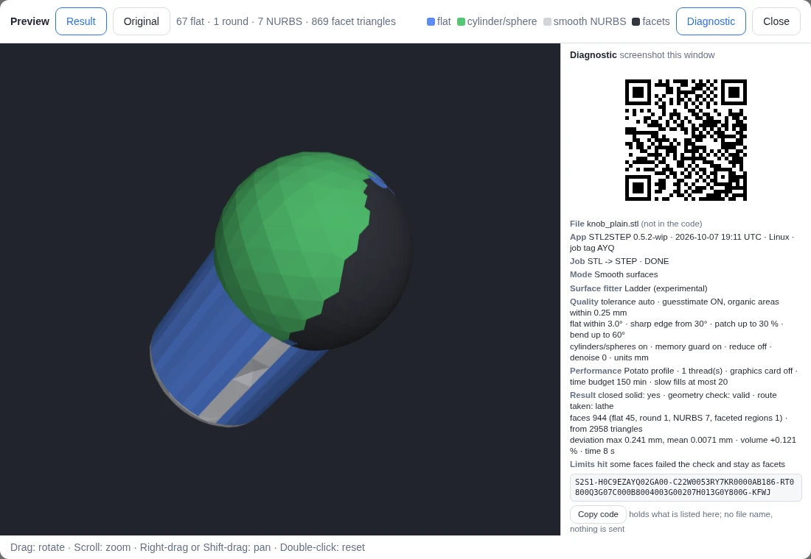

# The diagnostic code in the preview window: notes

**WORK IN PROGRESS: MANY FEATURES MAY BE BROKEN** (STL2STEP 0.5.2-wip, 7 October 2026)

## What it is for

When a conversion goes wrong, or just looks odd, the useful questions are always the same: which
mode, which surface fitter, which quality settings, on what kind of computer, and what came out.
Answering them used to mean copying the log and remembering what was ticked.

Now the 3D preview window carries a **Diagnostic** panel: a QR code, the same facts in plain
words beside it, and the code as text. **One screenshot of that window is a complete report.**
Whoever receives it can read the words, or have the QR read back exactly:

```
python app/stl2step.py diag screenshot.png         # a screenshot or a phone photo of the screen
python app/stl2step.py diag S2S1-H0C9EN5SN...       # or the code, typed or pasted
```

A failed job has no preview, so its result card has a *Show the diagnostic code* button that
opens the same panel. A *Smooth surfaces* or *Exact facets* conversion run from the command line
prints its code at the end.



## Where the idea comes from

The ErrCode project (same author) packs error reports into a short string for a QR code:
4-character codes from a dictionary, **multiplexed** with a time stamp and a session tag into
`EC1-<TIME:5><SESSION:3>-<CODE:4><CODE:4>...`, using only the characters of QR's compact
"alphanumeric" mode. This is the same idea applied to a job instead of to errors: several
records in one string, each read with a lookup table.

What is shared with ErrCode, so that the two can be told apart at a glance and read by the same
habits:

- Crockford base32 (`0123456789ABCDEFGHJKMNPQRSTVWXYZ`; a typed `O` is read as `0`, `I` and `L`
  as `1`), and nothing but `0-9 A-Z -`.
- The time stamp: minutes since 2026-01-01 00:00 UTC in 5 characters.
- A 15-bit tag in 3 characters (here taken from the job's id, so two screenshots of the same job
  carry the same tag).

What is **not** shared: ErrCode's dictionary of 132 error entries is not in this repository, so
this code does not contain `EC1` codes. A failed job gets one of ten broad error classes of its
own (see below) and a 15-bit tag of the error text, enough to tell "the same error again" from
"a different one". Putting real ErrCode codes into an `E` record is the obvious next step once
that project is published as a package; the format has room for it (unknown records are
skipped by older readers).

## The format

```
S2S1-H<header>-C<convert settings>[-X<outline settings>]-R<result>[-E<error>]-K<check>
```

Each record is one letter followed by bit fields, most significant bit first, 5 bits to a
character. `app/diagcode.py` holds the table (`FIELDS`); this is a summary.

| Record | Characters | Holds |
|---|---|---|
| `H` header | 14 | time (25 bits), job tag (15), app version major.minor.patch and the "-wip" flag (4 + 7 + 7 + 1), kind of job (convert, wash, scad, image), system (Linux, Windows, macOS, other), state (done, error, cancelled, running) |
| `C` convert settings | 21 | mode; surface fitter; units; performance profile; graphics card on/off; cylinders/spheres, memory guard, guesstimate switches; tolerance (0.005 mm steps, 0 = auto); organic tolerance (0.05 mm); plane angle (0.1 deg); sharp-edge angle; patch size; patch bend; reduce-to (thousands of triangles); denoise passes; threads; time budget (minutes); most slow fills; Ladder route if forced; Ladder guess; hardpoint labels used |
| `X` outline settings | 9 | only for *Extrude outline* and *Loft*: axis, source, smooth sketch, symmetric, outline tolerance, height, most slices, slice sensitivity |
| `R` result | 39 | closed solid?; valid?; route taken; eight "limit hit" flags; input triangles; faces, flat, round, NURBS, faceted regions; max and mean deviation (0.001 and 0.0001 mm); volume difference (0.001 %); seconds |
| `E` error | 4 | only for a failed job: one of ten classes, and a 15-bit tag of the message |
| `K` check | 3 | 15 bits of CRC-32 over everything before it |

Numbers too large for their field stop at the field's top value; "not measured" has its own
value (all ones) and reads back as unknown, never as zero.

The eight flags of `R` are read from the job's log: checkpoint written, fitter stopped and the
checkpoint kept, time budget reached, mesh reduced to fit memory, memory tight, organic areas
guesstimated, faces that failed the check kept as facets, second pass fell back to Classic. A
test checks that the words searched for are still in the converter's source, so rewording a log
line cannot silently switch a flag off.

## Why packed bits and not JSON

Measured with the same job (Ladder fitter, guesstimate on, all counts filled):

| What goes in the QR | Characters | QR size at medium error correction |
|---|---|---|
| **This code** | 89 | 33 x 33 modules (version 4) |
| ... with the outline record (Extrude / Loft) | 100 | 37 x 37 (version 5) |
| ... a failed job | 54 | 29 x 29 (version 3) |
| The same facts as compact JSON | 594 | 93 x 93 (version 19) |
| The plain words of the panel | 815 | 109 x 109 (version 23) |

At 4 screen pixels per module the code is a 164 px square that sits beside the 3D view and
still reads from a screenshot of a phone-width window. The JSON would need 404 px and the plain
words 468 px for the same module size.

## What is in it, and what is not

In the code: the app version, the time to the minute (UTC), the job tag, the settings and
numbers listed above, and "Linux / Windows / macOS".

Not in the code: the file's name or any path, the log, the error text, the computer's name,
its hardware, or anything else about it. The panel shows the file name and the error text in
words and says "(not in the code)" beside them, so they are in a screenshot only if you
screenshot them.

Nothing is sent anywhere. The QR is a picture drawn on the page; the server that draws it
listens on this computer only.

## Choices made

- **One QR, not several.** "Multiplexed" here means several records in one string. Splitting a
  report over two or three QR codes was considered and dropped: a single version-4 symbol holds
  everything, and one symbol cannot be screenshotted half.
- **The server makes the symbol, the page draws it.** The page stays free of third-party
  scripts. The symbol is made by `segno` (pure Python, BSD licence, about 0.6 MB installed), added to
  `app/requirements.txt`. If it is missing, the panel says so and still shows the words and the
  code.
- **Reading back uses OpenCV's QR detector**, which the Image tab already brings.
- **The panel is on by default** in the preview, with a *Diagnostic* button to hide it: the
  point is that a screenshot taken without thinking about it is already useful.
- **Settings of the other tabs are not carried yet.** Jetwash, SCAD and Image jobs get the
  header and the result record; the panel says that their own settings are not in the code.

## How far it was tested (7 October 2026, Linux only)

- 14 tests (`tests/test_diag.py`): every field round-trips within its step; a mistyped
  character fails the check; look-alike letters and lower case are forgiven; unknown records
  are skipped; a real conversion through the app's server carries its settings and result; a
  failed job has a code; the QR reads back from a made-up screenshot.
- In headless Chromium: a real conversion in the page, the panel with QR, words and code in
  one screenshot of the preview window, of the whole page, and of a phone-width (390 px)
  window; all three screenshots were read back with `stl2step diag`. Also a failed job, and the
  panel without `segno`.
- **A photograph of a screen** was only simulated: the page screenshot warped as if seen at an
  angle, blurred, with noise, saved as JPEG at quality 70. It read back. No real phone photo of
  a real screen has been tried, and moire from a real screen is the thing a simulation does not
  show.
- Not run on Windows or macOS. Not tried with a QR app on a phone (the content is a code, not a
  web address, so a phone will only show the text).

## First real photos (23 October 2026)

Three phone photos of the preview window on a real macOS screen (an M5 MacBook, the codes made on macOS by
0.10.1-wip), taken at an angle, with the screen's moire and glare, were read with `stl2step.py diag <photo>` on the
Linux test machine. All three QR codes read first time and decoded to every field, and each matched the code typed
in from the text under its QR. So the real-photo path now has a first result: it works when the whole symbol is in the picture. ([GHOST_CAT.md](GHOST_CAT.md) has
what the codes said.)
