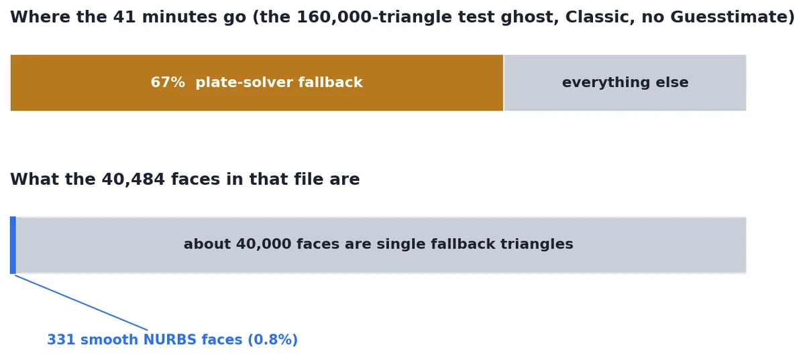
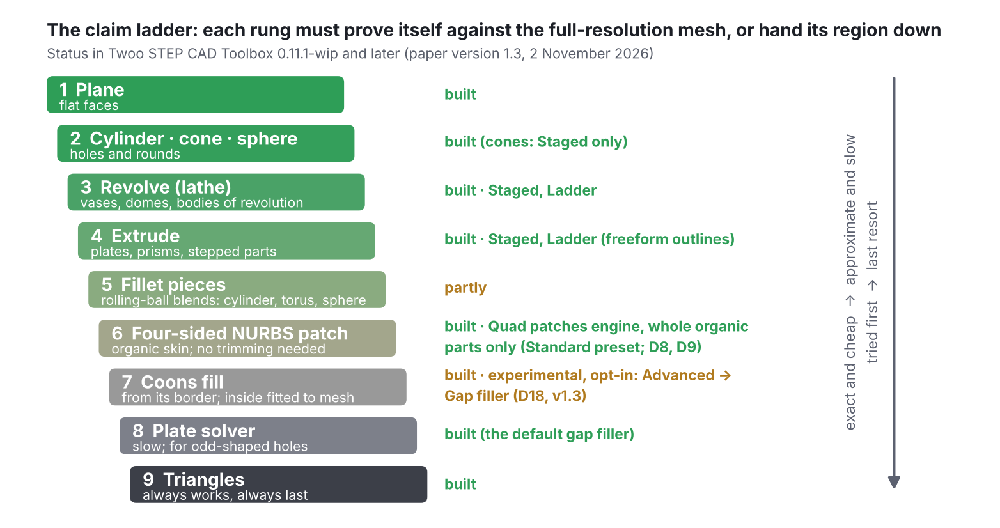
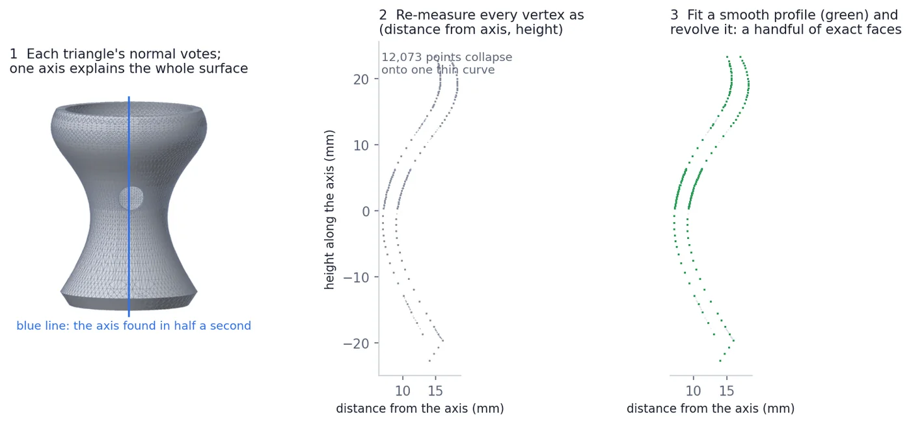
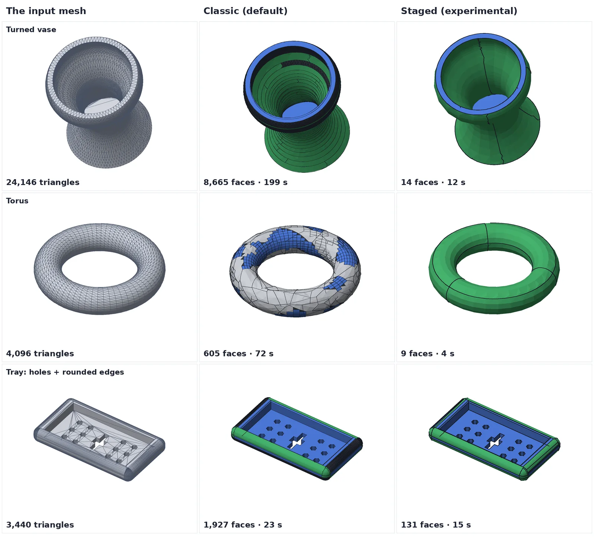
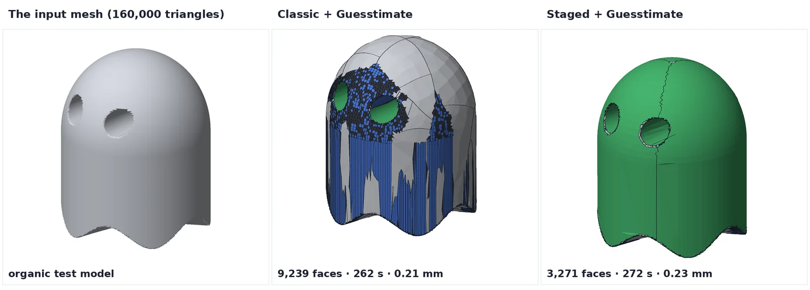
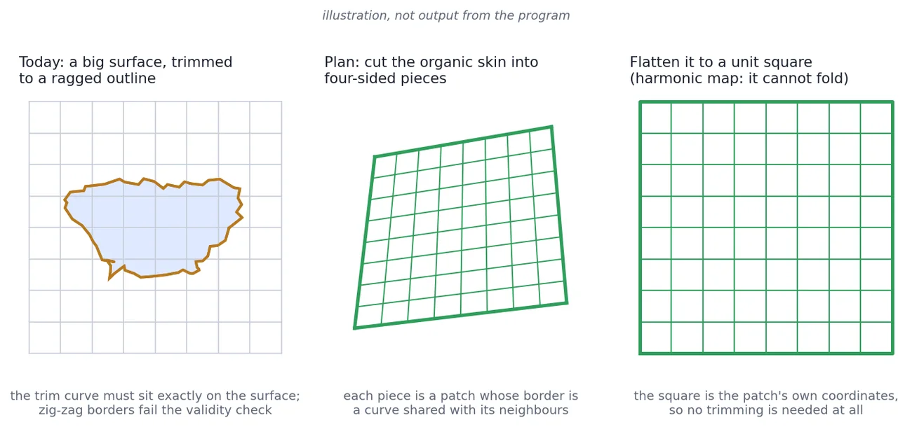
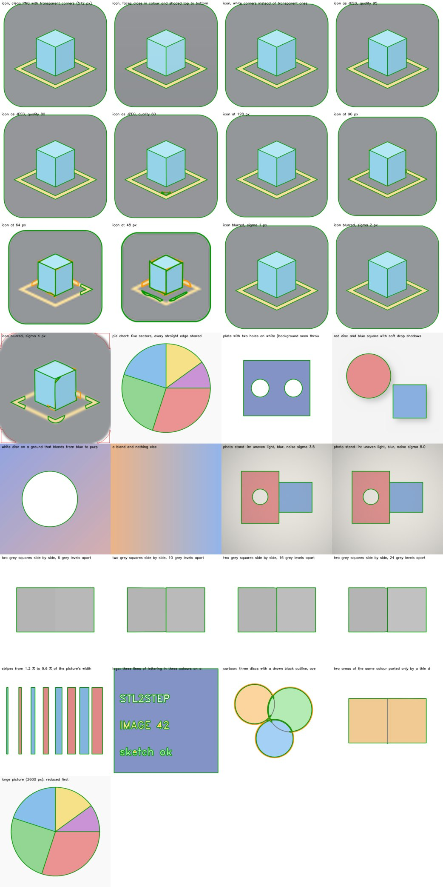

# Research notes: how to make STL → STEP cheaper and more accurate

**WORK IN PROGRESS: MANY FEATURES MAY BE BROKEN** (EVERYTHING to solid 0.10.2-wip)

This is a plain-English summary of a research report written for STL2STEP in October 2026. The report
was produced by an AI research agent (Claude) from papers, documentation, forum threads and open-source
projects, and was **not independently verified by the author**. It is published so that others can check it,
argue with it, reuse it or build on it. Every claim in the full report carries a link to its source:
**[FULL_REPORT.md](FULL_REPORT.md)** (about 7,000 words).

About the pictures: the part comparisons and the vase "finding the axis" figure are real output from this
project, rendered from the actual STEP files and meshes (the example parts are synthetic test models made for
benchmarking, not customer parts). The first chart uses figures from the report, and the claim ladder and
the four-sided-patch drawing are diagrams (the latter says so).

## The short version

1. **Most of the time and nearly all of the bloat come from fallbacks, not from fitting.** On the 41-minute
   test run, two thirds of the time went into one slow "plate solver" fallback, and about 40,000 of the
   40,484 faces in the result were single triangles that failed to become a smooth surface.
2. **Claim the exact shapes first.** Flats, holes, rounds, lathe shapes and extrusions can be recognised
   cheaply and written as exact faces. Only what is left over should go to the expensive freeform stage.
3. **Rebuild the freeform stage around four-sided patches** that share their border curves and need no
   trimming. Trimming is where today's faces fail.
4. **Speed comes from measuring less often, using processes instead of threads, and using the right
   distance library**, not from a graphics card.

Items 1 and 2 are now partly built into the app as the experimental **Staged** engine (see
[what is built and what is not](#the-plan-and-where-it-stands)). Items 3 and 4 are not started.

## 1. The problem: the work is in the wrong place

The converter tries to fit a smooth surface to every region of the mesh. When a fit fails a validity check,
it falls back to something slower and cruder: first a "plate" solver that bends a surface through sampled
points, and finally one STEP face per triangle. In the report's reading of the numbers:

- The plate solver is about **67% of the 41-minute run** on the test ghost.
- Only **331 of the 40,484 faces** are real smooth NURBS surfaces; the file is mostly triangles. That is also
  why the file is 107 MB, and why other CAD programs open it slowly (the report quotes users of other
  tools reporting freezes at 40,000–68,000 faces).
- Guesstimate mode proves the fitting itself is cheap (4.3 minutes) but still leaves 513 triangle regions, so
  making the mesh smaller does not cure the failures.

## 2. Idea: a "claim ladder"

*Redrawn 2 November 2026 with the current status (the first drawing, for 0.10.2's Classic engine, still marked rungs 6 and 7 "not yet"; the Quad patches engine already made four-sided Coons patches for whole organic parts).*

Think of nine rungs, from exact and cheap to approximate and slow. Each region of the mesh is offered to the
first rung; if the shape fits **within tolerance when checked against the original full-resolution mesh**,
it is claimed and written as one exact face. If not, the region is handed to the next rung. Triangles are
the last resort, not the default.

This also dissolves the "strict mode versus Guesstimate mode" split: tolerance becomes a property of each
region (tight where a surface is exact, loose where it is organic) instead of a switch for the whole file.

Practical details the report recommends for the upper rungs:

- **Find flat and round regions by walking from triangle to neighbouring triangle**, with sharp edges as
  walls, instead of guessing shapes from random points. On meshes exported from CAD this never merges two
  separate holes and does not leak across edges. (A study the report cites took 3–25 s on 13,000–38,000-face
  meshes with edge pre-splitting, but over an hour on a 100,000-face model without it.)
- **Fit holes and rounds to the mesh vertices, not the triangle centres.** CAD exporters put vertices
  exactly on the surface; triangle centres sit slightly inside it. At a 10° angular step the gap is about
  0.019 mm on a 5 mm-radius hole but 0.19 mm on a 50 mm-radius cylinder, so each region's tolerance should
  come from its own measured gap.
- **Snap near-equal values together** (parallel axes, equal radii, coaxial cylinders) so fragments of one
  plane or one cylinder merge into a single face.
- **Rounded edges (fillets)** are pieces of cylinders, tori and spheres. Tell them apart by the path of the
  imaginary rolling ball: a straight path is a cylinder, a circular one a torus, a point a sphere.

## 3. Idea: find lathe shapes with one small calculation

A vase, a dome, a torus, a wheel: anything that could be made on a lathe has an axis. The report describes a
cheap test (from Pottmann et al., 2004). Each triangle contributes its position and its normal to a 6×6
table of numbers; how many of that table's eigenvalues are close to zero says what kind of shape it is, and
the matching eigenvector **is** the axis. It takes one pass over the triangles plus a small fixed-size
calculation. On the test ghost it takes about half a second.

| Near-zero eigenvalues | What the surface is |
|---|---|
| 3 | a plane or a sphere |
| 2 | a cylinder |
| 1 (small screw pitch) | a surface of revolution (a cone is the straight-profile case) |
| 1 (very large pitch) | an extrusion |
| 0 | freeform: leave it to the patch stage |

Once the axis is known, every vertex is re-measured as (distance from the axis, height along it). A whole
revolution then stacks up into one thin curve (middle panel above). Fit a smooth curve to that, revolve it,
and you have one exact face where there used to be thousands. The report estimated that this "roughing"
step could claim about **83% of the test ghost's surface**; in our implementation the roughing stage claimed
79–81% of it.

Extrusions are the same idea with a direction instead of an axis (found from a 3×3 table, even cheaper).
Pipes are cheap too. General freeform sweeps are not worth it: the best published method took 15–30
minutes on a 414,000-vertex model and needs hand-tuned thresholds.

## 4. What this did on test parts

Blue = flat, green = cylinder / cone / sphere / lathe, light grey = smooth NURBS, dark = kept as triangles.
Black lines are the outlines of faces in the STEP file. The thin zig-zag lines on the Staged vase are the
seams where one lathe face meets the next; they follow mesh edges, which is a known rough edge.

| Part | Classic (default) | Staged (experimental) |
|---|---|---|
| Turned vase (24,146 triangles) | 8,665 faces, 199 s, max deviation 0.044 mm | **14 faces**, 12 s, 0.025 mm |
| Torus (4,096 triangles) | 605 faces, 72 s, 0.19 mm | **9 faces**, 4 s, 0.076 mm |
| Tray with holes and rounded edges | 1,927 faces, 23 s, 0.076 mm | **131 faces**, 15 s, 0.076 mm |
| Bracket (332 triangles) | 8 faces | 8 faces |

A 160,000-triangle organic test model, both with Guesstimate on:

Staged claims the smooth body (and the eye tunnels) as round faces; Classic cuts the same body into
patches and flat strips and leaves a band of triangles around the eyes. The face count drops from 9,239 to
3,271 at about the same speed (262 s against 272 s) and a similar deviation (0.21 mm against 0.23 mm, both inside the 0.3 mm organic
tolerance).

**Where Staged is not better** (also stated in the main README): the same ghost at strict tolerance without
Guesstimate took 75 minutes and 4.3 GB of memory and ended as an all-triangle solid (Classic: 41 minutes,
40,484 faces), and a non-watertight 100,000-triangle plate did not finish in 25 minutes. All numbers are from
a 2-core Linux machine and synthetic parts. That is exactly why it is opt-in.

## 5. Idea: rebuild the freeform stage from four-sided patches

*Illustration, not program output.* A NURBS surface is a rectangular grid, so any region that is not
four-sided has to be cut out of a bigger surface ("trimmed"). Trimming demands that the cut curve lies exactly
on the surface and does not cross itself, and zig-zag borders traced along mesh edges break both rules; on
the test ghost roughly 150 patches failed validity this way. The report's alternative is thirty years old
(Eck and Hoppe, 1996) and used by commercial auto-surfacing:

1. Cut the leftover into four-sided regions (a pip-installable remesher, `pynanoinstantmeshes`, can give a
   quad layout).
2. Fit **one smooth curve per shared border**, so neighbouring patches use the very same edge.
3. Flatten each region onto a unit square with a *harmonic map* (every vertex at the average of its
   neighbours), which cannot fold over itself.
4. Use that square as the patch's own coordinates. The face needs **no trimming at all**.
5. Where a patch still fails, use a cheap closed-form fill (a Coons patch) before the slow plate solver.

Building faces on shared edges also removes the sewing step: one open-source project measured shared-topology
construction as 2.6–3.2 times faster than build-then-sew.

## 6. Smaller ideas

- **Decimate (reduce the triangle count) only the organic leftover**, after the exact shapes have been
  claimed on the full mesh, with region borders locked and a record of which fine triangle each coarse one
  came from. Then verify the distance in **both directions** (the quadric reducer used by pyfqmr promises no
  maximum error) and check the mesh is still watertight.
- **Find rounded edges by curvature, not by the angle between two triangles.** On scans a real edge is
  spread over 3–5 triangles of 20–30° each, so no single mesh edge looks sharp. Crest lines or "normal
  voting" find the centre of the rounded band.
- **Be careful with mesh repair tools.** Some are GPL, some re-mesh the surface, and one warns it may fail on
  tessellated CAD. Merging duplicate vertices is usually enough.

## 7. Where the remaining minutes go, and how to get them back

- **Use processes, not threads.** The OpenCASCADE binding used here (OCP) does not release Python's global
  lock; a user who tried 24 threads found it slower than serial. Separate processes gave a 4–8× speed-up on
  16 cores. Start them with the `spawn` method, and give workers only NumPy work so they never load the CAD
  kernel (that keeps memory low on 8 GB machines).
- **Stop checking face by face.** Evaluate each face's surface on a small grid, pool all the samples, and make
  one distance query. The choice of library matters enormously: `trimesh.proximity.closest_point` took
  32 s for 500,000 queries where `pysdf` took 0.059 s. (`pysdf` is approximate; use `libigl` or
  `point-cloud-utils` when you need the exact closest triangle.)
- **Run the "merge faces on the same surface" step only on the analytic faces.** It took 75–90 s on a
  465-face file, can do nothing for a patch network, and has turned valid shapes invalid.
- **A graphics card does not help here.** OpenCASCADE is CPU-only and the machine-learning methods in
  this area need big GPUs, are trained mostly on CAD benchmarks, and mostly have licences that clash with this
  project's. The report's conclusion is that cores matter more than a GPU.

## 8. What commercial tools do

Every commercial tool the report looked at splits the problem the same way. Fusion's *Convert Mesh* has
Faceted, Prismatic and Organic modes (the Organic default is 100 faces); Geomagic Design X segments a scan into
planes, cylinders and cones and wraps the rest in four-sided NURBS patches; SpaceClaim's Auto Skin trims fitted
CAD faces into the facet regions and "autoskins" what matches nothing. That is the architecture described
above. No vendor publishes face counts, tolerances or run times, so a project that reports measured
deviation, face count and time per test model on named hardware offers something the paid tools do not. That
is what [`tools/bench.py`](../../tools/bench.py) is for.

## 9. Second round (October 2026): machine vision, combining the techniques, and "easy things first"

Three more reports followed the first one. They are published in full, with every source link, as
[MACHINE_VISION.md](MACHINE_VISION.md), [COMBINING.md](COMBINING.md) and [EASY_FIRST.md](EASY_FIRST.md).
The same caveat applies: AI-written, measured in a 2-core cloud sandbox and **not on the project's target
laptops**, not independently verified. The short version of each:

**Could cheap machine vision help?** Not pictures. Rendering the mesh and running circle finders, edge detectors
or small neural networks on the image throws away what the STL already holds exactly (facet normals, adjacency,
vertices on the design surface), costs more than the stages it would replace, and cannot measure anything to CAD
tolerance (a 1024-pixel picture of a 200 mm part is 0.2 mm per pixel). What *does* help is the vision toolbox
(histograms, voting, contour tracing) applied to the mesh's own data: a histogram of facet normals finds every
flat, extrusion direction and lathe axis in milliseconds; cutting the part at the heights of its flat faces and
fitting lines and arcs rebuilds prismatic parts exactly. Learned models are not worth it on a GPU-less i3: the
small ones are slow, brittle or unlicensed; the big ones need minutes per part and still drop small features.

**Do the techniques combine?** They form one ladder, and the ladder's value is in the work it lets you *skip*.
Profiling the app showed where the time went: on the knob half the run was the build/check/sew/repair loop
re-running when a face failed; on the organic blob three quarters was a flat-and-cylinder search that finds
nothing; on the dense vase half was plane detection for a part that is 84 % lathe. The author's idea that
vision becomes cheap *after* the boundaries are known has the right premise and the wrong conclusion: once a
boundary exists it is vertex data, and fitting the vertices is faster and exact (a per-hole window render cost
4–65 ms *per hole* and still had sub-micron bias; all six loops of a region from vertices cost 2–60 ms and gave
r = 1.500000). Three genuine conflicts are fixed by ordering: never reduce the mesh before the normal histogram
or hardpoint labels are used; snap after the tolerance gate and re-check; heal (Jetwash) after the gate.

**Easy things first, then guesstimate the rest.** Claiming simple surfaces first is safe only with two gates
(distance *and* normal angle: a distance gate alone passes any cylinder over about 1 m radius as a plane on a
20 mm region). Cheap signals route a part correctly on 25 of 26 test meshes, and routing is mandatory rather
than optional: the same Staged path is a 20× win on vases and a 2× loss on a plate. Two one-line defects in the
app's flat-face detector were found (coarse cylinder facets and a 15 mm fillet accepted as flats because the
border test counts edges instead of measuring them; the subdivided-knob failure is a vertex-density-dependent
width test, not the crease angle). The Guesstimate saving is the plate-filler skip: 0.1, 0.3 and 1.0 mm gave
identical results on the test meshes. `refine_rounds` is not the lever; caps on settling passes, plate fills
and the faceted fallback are.

### What was built from it: the Ladder engine (0.4.0-wip, opt-in)

`--engine ladder` (or *Ladder* in Settings). It computes the signals, picks a route and sets the classic
converter up for it; Classic itself is untouched and stays the default.

| Mesh (this 2-core machine) | Classic | Ladder | Route |
|---|---|---|---|
| Dense lathe vase, 24,146 triangles | 264 s, 8,980 faces | **8.0 s, 14 faces**, max 0.025 mm | lathe (revolves claimed before the flat search) |
| Organic blob, 9,944 triangles | 17 s, 20 faces, 0.059 mm | **2.4 s**, 20 faces, 0.108 mm (Guesstimate) | organic (flat and cylinder searches skipped) |
| Knob, 2,958 triangles | 17 s, 1,103 faces, 0.129 mm | 12 s, 951 faces, 0.129 mm | lathe |
| Fine stepped shaft with cross hole | 23 s, 2,190 facets (fallback) | **1.8 s, 8 faces**, 0.007 mm | lathe, no revolve found → length rule |
| Block with 15 mm fillet | 0.4 s, 20 planes (fillet as flats) | 0.3 s, 9 faces, fillet a true cylinder | prismatic |
| Bracket / plate / tray | 0.5 s / 7.8 s / 11.8 s | same results, same times | prismatic |
| Subdivided knob (stress case) | 86 s, 2,234 facets (fallback) | 21 s, 967 faces, 0.07 mm | lathe |
| Organic figure, 160,000 triangles | 41 min, 40,484 faces (Classic); 262 s, 9,239 faces, 0.21 mm (Classic + Guesstimate) | 318 s, 3,271 faces, 0.26 mm, peak 1.3 GB | mixed (lathe shapes first, then Guesstimate) |

Known limits: 13 synthetic CAD meshes and two synthetic organics, no scans, no real-world downloads yet, nothing
run on the real i3; a mixed part beyond the knob was not tested; the filleted bracket keeps a 0.3 mm deviation
that neither engine explains yet. The thresholds are in `app/ladder.py` with their margins.

## 10. Third round: never crash on a potato, finish in 45 minutes on a laptop

Report: [POTATO.md](POTATO.md). The short version: an out-of-memory inside OpenCASCADE cannot be caught from
Python (Linux kills the process, Windows grinds into the pagefile and then hangs), so safety has to come from
not getting there and from always having a file on disk. Built from it (all engines, 0.4.0-wip): a checkpoint
STEP written before the slow freeform fitting on meshes of 20,000+ triangles and kept if the fitter dies; a time
ceiling and plate-fill allowance in every performance profile (Potato 2.5 h / 20 fills, Moderate and Extreme
40 min / 60–120) after which unfinished areas become facets and the file is written; the plate filler skipped
when memory is nearly full; the faceted fallback reduced within half the tolerance above 20,000 triangles so the
file stays openable; a cache of built-and-checked faces across rebuild cycles (bit-identical output, about half
the regions skipped per repeat cycle); and, in the Ladder engine only, a density-independent flat-strip test that
turns a subdivided knob's 86 s / 2,234-facet fallback into 20 s / 967 faces at 0.07 mm.

What this does not do yet, bluntly: the time ceiling is soft (it stops *asking* for more work; a single plate fill
or sewing call already running cannot be interrupted, so the real worst case is the ceiling plus one long call);
making it hard needs each risky call in a child process with a timeout, which also needs the fitter refactored into
pure functions, and that same refactor is what a two-process fit pool and progressive organic fitting need. The i5
estimate rests on published benchmark ratios (about twice the i3 or the sandbox single-thread speed, less under
thermal throttling), not on a run on either machine.

## 11. Fourth round: could the app work like a slicer?

Report: [SLICER.md](SLICER.md). The idea: slice the STL into layers like a 3D-printing slicer, with a very fine
"virtual nozzle" (0.001 mm) for outer walls, tops and bottoms and a coarse one (1 mm) inside to save work.
The short version: the instinct is right and the mechanism is wrong.

- A STEP solid has no inside, only a skin, so the "coarse interior" saving is already total with no setting.
- Walls parallel to the slicing direction are captured exactly at any layer spacing.
- Tops, bottoms, domes and shallow slopes are where slicing stair-steps, and the error there is the *layer
  height*, not the nozzle: a finer nozzle does nothing; one slice placed exactly on each flat level does
  (knob tops 0.191 mm → 0.075 mm in the prototype). A dome needs hundreds of layers or a proper curved face.
- Measured slice counts for a 0.01 mm tolerance: 5 for a bracket; 419, 504 and 1,111 for the knob, blob and vase.
- 0.001 mm is finer than the mesh itself (an exporter's chord error is typically 0.01–0.1 mm), so a contour that
  fine reproduces the facets. The useful "nozzle" is the tolerance of the line/arc fitter, which recovers the
  true circle from the facet corners — what *Smooth sketch* already does.
- The prototype beat the existing engines on one part (knob: 2.9 s, 108 faces, 0.079 mm against Ladder's 13.4 s,
  951 faces, 0.129 mm), was about 18 times less accurate than Classic on the bracket, and failed on every part with
  holes, on the dense vase and on the organic blob (a loft takes one loop per layer, so layers with holes or
  several islands must be split into slabs and cut, which the prototype did not get working).

So: no separate slicer mode (the app's Loft and Extrude outline modes already *are* a slicer that keeps only the
perimeters). Worth taking from slicers, none of it built yet: a section at every flat level and at every change
in the number of loops, each slab extruded or lofted on its own; in-between heights chosen by an error model
(curvature for lofts) instead of the area curve; the outline tolerance taken from the mesh's own chord error; and
a per-island slab loft as a fallback in the Ladder engine when a turned part has no findable axis. Slicer source
code (PrusaSlicer, CuraEngine, ArcWelder) is AGPL and cannot be copied into this project; the algorithms can be
re-implemented. The first measurement run was cut short and slicing along three axes was never run.

## 12. Working notes from 0.5.2: colour transitions and the diagnostic code

Two things were built in October 2026 that are not about meshes, and their notes are kept here so that they
travel with the app. Unlike the reports above, these are not literature research: they record what was tried on
this project's own test pictures, what was dropped and why, and what was measured.

- **[TRANSITION_TRACING.md](TRANSITION_TRACING.md): tracing every colour change of a picture** (the experimental
  option of the Image → STEP tab). The tracer asked one question, "where does the part end and the background
  begin?", which finds the outline of an icon and nothing of what is drawn inside it. A first design (find the
  picture's flat colours, trace each colour) worked on clean flat graphics and failed on shaded faces, JPEGs
  and photographs. What is built instead starts from the edges: mark every sharp colour step, let the rest fall
  apart into areas, compare each area with its neighbours *locally*, and hand each area to the existing
  detector, so the same sharp-edge test still decides what is real. On 29 simulated pictures: every area of a
  redrawn icon within 0.1 % of its true size, gradients and soft shadows give no lines, and the limits (drawn
  outlines, same colour both sides of a line, faint edges, tiny or blurred pictures) are reproduced in the bench.

  

- **[DIAGNOSTIC_CODE.md](DIAGNOSTIC_CODE.md): the code in the preview window.** A job's settings and result
  packed into about 90 characters (a 33 x 33 QR) using the conventions of the ErrCode project; the same facts
  as JSON would need a 93 x 93 symbol. What is in it and what is deliberately left out, and how far reading it
  back from screenshots was tested.

## 13. Working notes from 0.6.0: drop-in plug-ins (paused in 0.7.0)

- **[PLUGIN_SYSTEM.md](PLUGIN_SYSTEM.md): add-ons that are updated on their own — built in 0.6.0-wip, taken out again
  in 0.7.0-wip and paused.** Kept here, with the to-do list for when it comes back. Entry points, stevedore,
  Yapsy, pluginbase and a hand-rolled registry were weighed against "drop a folder or zip in, no pip, hooks the app
  declares, usable by several apps". Chosen: pluggy (MIT, the hook library of pytest) for the hooks, plus a small
  app-neutral loader (`app/plugkit.py`) for manifests, hook versions, safe zip install, update, roll back and
  on/off. The ImageToSketch tracer is the first drop-in. Design rules for hook versions, what is tested (16 tests),
  and what is not (Windows, a package shared by two drop-ins, no sandbox by design).

## 14. Working notes from 0.8.0: where the time goes, tab by tab

- **[EFFICIENCY.md](EFFICIENCY.md): every tab profiled, the safe speed-ups made, the rest written down.** On the
  11-mesh benchmark the three main engines went from 923 to 698 s with every result identical (Classic on the
  turned vase 299 → 164 s); Jetwash on its slowest test file from 669 to 140 s, also identical; Image and SCAD
  jobs start a second sooner. Also: a located warning when the STEP is far from the mesh, a hint pointing turned
  parts at the Ladder engine, and measured findings left for a decision (Staged on extruded profiles; a preview
  cache; a warm worker).

## 15. Working notes from 0.9.0: quality presets

- **[PRESETS.md](PRESETS.md): Draft, Quick, Standard, Fine and Advanced for the STL → STEP tab.** Each preset is only
  a set of values for existing settings (Standard is exactly the old default). Measured through the real job
  worker on 12 meshes: Draft 158 s, Quick 163 s, Standard 370 s, Fine 702 s in all, every result a closed valid
  solid; Fine was the best on six and the only one that kept the narrow cusps of the blob plates. Exact facets was
  measured as a "fastest" candidate and turned out slower than Quick on every organic part.

## 16. Working notes from 0.9.1: what runs in compiled code

- **[NATIVE.md](NATIVE.md): every dependency by what it runs as, and the two places Python sat in the way.**
  OpenCascade, numpy, scipy, GEOS, libspatialindex and OpenCV already did the heavy lifting. Fixed: trimesh's
  winding repair walked the faces in pure-Python networkx (now scipy, `app/meshfix.py`: 28 times faster, a
  162,000-triangle figure with flipped faces converts in 9.4 s instead of 26.1 s, same result on 264 of 280 test
  cases, every one-piece mesh among them), and the shape-guessing loop spent more time in numpy's argument handling than
  in its sums (rewritten bit-for-bit: the benchmark about 8 % faster, every result identical). Found and left open:
  the vase's Classic result varies from run to run, with the old code too.

## 17. Working notes from 0.9.2: the calibration sheet

- **[CALSHEET.md](CALSHEET.md): ImageToSketch 0.10.0's marker frame and 50 mm stand in the Image → STEP tab.** The
  frame gives scale, tilt and lens bend from up to 160 marker corners; the stand's marker, 50 mm above the paper,
  measures the camera distance, so a tall part needs only its height typed (within 0.7 % on ImageToSketch's
  simulated photos, against up to 40 % for the token sheet). What was checked here (a drawn picture, the downloads,
  the page at two widths) and what was not (any real print, stand or photo).

## 18. Working notes from 0.10.0: five defects found by profiling and tracing

- **[IMPROVEMENTS_0_10.md](IMPROVEMENTS_0_10.md): quality and speed of every tool except Hardpoints, with the
  12-mesh benchmark before and after.** Results were not repeatable (OpenCascade's plate filler chains loose
  edges through a map hashed on memory addresses; it now gets one chained wire of its own); a face's repair
  widened *shared* outline vertices to millimetres and so let neighbours 1.3 mm off through, or refused good
  patches (fitted and flat faces now get their own outline copy; the knob 1,103 faces → 963, 0.129 → 0.058 mm);
  Draft never finished on a dense flat-sided mesh (a fan bug in the flat-face retriangulation, and a lost start
  time for its 60 s cap); Jetwash's all-at-once attempt (batches of 16 now; the tray 102 → 63 s); and Quick's
  prismatic route now claims extruded outlines first with the plain fitter as a measured fallback (Quick's faces
  over the 12 meshes 4,767 → 1,574, its worst deviation 3.0 → 0.19 mm). Also: why slicing with a tiny nozzle adds
  nothing, and a costed sketch of a wireframe-then-Coons-patches engine for organic shapes (QuadriFlow is
  BSD-licensed).

## 19. Working notes from 0.10.1: quad patches and private outlines

- **[QUADPATCHES.md](QUADPATCHES.md): the experimental Quad patches engine for organic shapes** (QuadriFlow quad
  layout, one Coons patch per quad with its inside fitted to the mesh, all patches solved together with a soft
  no-crease condition along shared edges). The only engine within tolerance on every organic test shape, no
  facets, the smoothest seams (the bumpy ring: 0.028 mm and 3° against Classic's 0.144 mm, 50 facet areas and
  32°); the 162,000-triangle figure in 7 s against Classic's 421 s; more faces on busy shapes. How each choice was
  measured, how QuadriFlow is built and shipped (BSD-3; a 64-bit Linux build in the repository). Also: round faces
  on private outlines (the knob 963 → 69 faces).

## 20. Working notes from 0.10.2: the first real model, and the defensive publication

- **[GHOST_CAT.md](GHOST_CAT.md): a real downloaded model on a real Mac.** A 91,676-triangle ghost-sheet cat (a
  third-party Printables model, used only as a test) on an M5 MacBook: Standard 4 min 23 s, 17,197 faces (829
  NURBS), worst point 1.110 mm (an open defect); Quick 81 s, 11,864 faces, 0.228 mm; Draft 79 s, 11,117 faces,
  0.271 mm. The face totals and the 50 MB file are mostly facets (about 2.4 KB each, against 16 KB a NURBS face).
  The diagnostic QR codes were read back from phone photos of the screen. Is it the most advanced free converter?
  Possibly; nothing else free that fits organic NURBS was found, and nothing has been benchmarked side by side.
- **[SOLID_EVIDENCE.md](SOLID_EVIDENCE.md): <u>**SOLID**</u> evidence, a defensive publication** of every method in
  the STL → STEP converter (fifteen disclosures with parameters and variants: the claim ladder and its two gates,
  millisecond routing, lathe and extrusion roughing, two-tolerance organic fitting, private outlines with refusal
  by widening, deterministic plate-filler input, always-finishing safeguards, the quad-patch engine, Jetwash
  batching, Smooth sketch, the diagnostic code, the finished-solid checks and the new Standard), with the prior art it does not claim and all the free research
  findings in one place. A PDF copy for archiving: [SOLID_EVIDENCE.pdf](SOLID_EVIDENCE.pdf).

## 21. Working notes from 0.10.2: a new Standard

- **[STANDARD.md](STANDARD.md): why Standard was so unimpressive, and what it is now.** The old Standard (Classic)
  treated every part alike: it searched for flats and cylinders on a cat and held a cat's cheek to a few hundredths
  of a millimetre, so patches failed into facets (4 min 23 s on the real cat, against Quick's 81 s with a closer
  worst point). Measured on 17 test meshes it was the same or worse than Quick on nearly every one. Standard now
  picks the engine by the part's shape: Quad patches for smooth organic parts (on 5 organic shapes the only preset
  with all 5 within the tight tolerance and no facets), the Quick way for everything else. Two Classic defects that
  put results millimetres off were found and fixed (a face in the wrong place; round faces OpenCascade can't draw),
  oval plate 3.66 → 0.08 mm, blobs plate 3.0 → 0.18 mm; also a mesher that ran without end when a shape was meshed
  twice.

The report ranks 14 steps by benefit per effort. This is the status in STL2STEP **0.4.0-wip** (the first report's 14 steps; the second round's own ranking is in [EASY_FIRST.md](EASY_FIRST.md) and [COMBINING.md](COMBINING.md)):

| # | Step | Status |
|---|---|---|
| 1 | Benchmark harness | **Done** (`tools/bench.py`) |
| 2 | Batched verification (pooled samples, one distance query, one validity check) | Not done (a face the mesher gives up on is now re-meshed coarser instead of counting as a 0.5 mm hole) |
| 3 | Replace the plate-solver fallback (Coons fill first) | **Built, opt-in** (2 November 2026, paper D18, [COONS_FILL.md](COONS_FILL.md)): Advanced → *Gap filler* → Coons. Within the tolerance on 14 of 29 hard test patches against 6 for the plate filler, but about twice as slow per patch and whole parts came out about the same, so the plate filler stays the default |
| 4 | Trimmed-face hardening | **Partly**: the Staged engine trims its faces directly on their own surface, then writes the STEP, reads it back and repairs what failed. Classic is unchanged |
| 5 | Process pool for per-patch fitting | Not done (the Second pass already runs in parallel, which is a different thing) |
| 6 | Lathe roughing | **Done, opt-in** (Staged engine; the Ladder engine runs it before the flat search on turned parts) |
| 7 | Primitive rewrite on full-resolution vertices (adjacency growing, curvature-parametrised refit, snapping) | Not done (the Ladder engine's route signals and the length-weighted flat-border rule are the first pieces) |
| 8 | Sub-region extrusions and exact circular hole rims | **Partly**: extrusions of freeform outlines on smooth regions; exact hole rims not done |
| 9 | Harmonic parametrisation and shared border curves | Not done |
| 10 | Quad layout, untrimmed patches, no sewing | Not done |
| 11 | Region-wise decimation with locked borders and ancestry | **Partly**: Staged + Guesstimate reduces the organic leftover with locked outlines and carried labels; no two-sided certification yet |
| 12 | Curvature-based feature lines | Not done |
| 13 | Fillets by spine (cylinder, torus, sphere with shared radius) | Not done |
| 14 | Pipes, approximate G1, compact-STEP option | Not done |

## Open questions (good places to help)

The report names these as unmeasured rather than assumed:

- How long the quad remesher takes on 100,000-triangle meshes.
- How many control points an organic region needs at 0.3 mm compared with 0.05 mm.
- How robust trimming a revolved face against a freeform neighbour is. This junction between an exact face
  and a patch is the one place the research found recipes but no measurements. A small test file that
  isolates it would be the cheapest insurance in the plan.
- The licences of `libigl`, `pysdf`, `point-cloud-utils` and the decimation packages, which the report did
  not verify.
- Real-world parts. Everything measured so far is synthetic test models on a 2-core Linux machine. If you
  can share a mesh that converts badly, or benchmark on your own hardware, please open an issue.

To compare engines on your own mesh:

    python tools/bench.py part.stl --engines classic staged ladder
    python tools/bench.py part.stl --engines classic staged --guess 0.3

## Licence notes from the report

The report checked licences before recommending anything, because this project is
[PolyForm Noncommercial](../../LICENSE.md). Summary of what it found (not legal advice; check before you
bundle anything):

| Component | Use | Licence found |
|---|---|---|
| pynanoinstantmeshes | quad layout | BSD; pip wheels |
| cadquery-ocp 8.0.1 | OpenCASCADE kernel | Apache-2.0 per PyPI |
| boromyr/STL2STEP, mesh2step | verification discipline, shared-topology construction | MIT |
| libigl Python, pysdf, point-cloud-utils, pyfqmr, fast-simplification | maths, distance, decimation | not verified |
| MeshToFeatures | snapping and feature logic | LGPL-2.1: reimplement the idea |
| CGAL algorithm packages, pymeshfix, EfPiSoft, NVDNet, BrepGen | none | GPL family: do not copy |
| DeFillet | none | AGPL-3.0 |
| Point2CAD code and weights | none | CC-BY-NC, personal and research use only |
| Yoshizawa crest-line code | none | research and education only: reimplement from the paper |

---

Required Notice: Copyright Matthew Armstrong (https://github.com/The-Dorkknight). Source-available under the
[PolyForm Noncommercial License 1.0.0](../../LICENSE.md), not open source. The summary and the full report were
written with AI assistance and are provided as is, with no warranty; check the cited sources before relying on
any figure.
