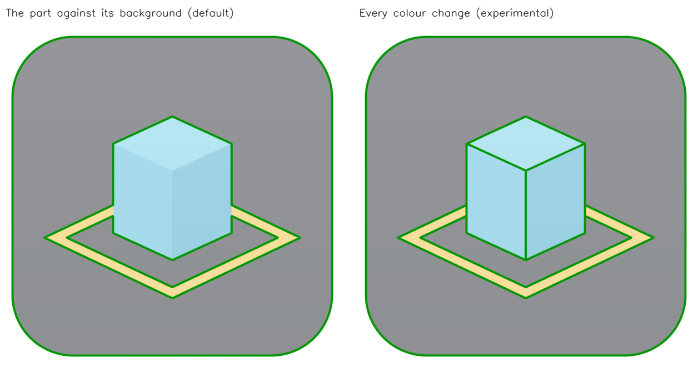
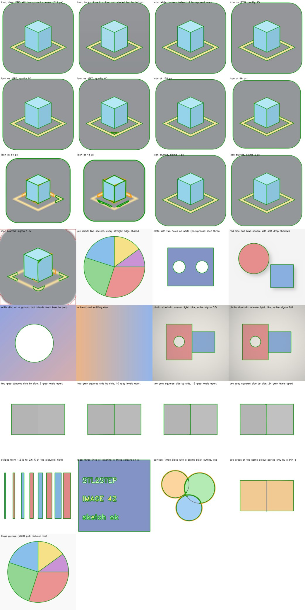

# Tracing every colour change (Image → STEP tab): notes

**WORK IN PROGRESS: MANY FEATURES MAY BE BROKEN** (STL2STEP 0.5.2-wip)

*These are the notes of the ImageToSketch project (same author), whose tracing library is the engine of the Image → STEP tab; they were written for ImageToSketch 0.8.0; this build carries 0.9.0, which adds `weld.py` (neighbouring colour areas share one curve for each edge they share, option *Neighbours meet exactly*). They are copied here so that the research travels with the app. `detect.py`, `pipeline.py` and the others named below are in `app/imagetosketch/`; the tests and the bench (`bench/transitions.py`) are in the ImageToSketch repository, and the STL2STEP side is covered by the `Transitions` tests in `tests/test_image.py`. Where the text says "sketch" or "FreeCAD dialog", that is ImageToSketch's own front end: in STL2STEP the result is a STEP file, plus an SVG / DXF if you ask for one.*

*Experimental. Added in v0.8.0-wip, 7 October 2026. Everything measured here is on simulated
pictures; see [What is not tested](#what-is-not-tested).*

## The report that started it

A screenshot of the FreeCAD dialog (v0.4.0) tracing an app icon, `simplemesh-512.png`: a dark
grey rounded square that fills the picture, a pale blue cube drawn in three shades, a yellow ring
on the "floor" around it. Result: `1 outline (0 holes): 4 arcs, 10 lines. 0 borderline, 4
rejected`. The yellow ring was outlined; the grey square's rounded corners were found and thrown
away (red); the grey square had no outline; nothing marked where the cube meets the grey, or
where one face of the cube meets the next.

Two different causes:

1. **The grey square.** That was the picture-edge problem fixed in v0.6 and v0.7: the square
   runs to the edge of the picture, and v0.4 rejected anything that touched the edge. The copy
   in the screenshot was older than the fix. With v0.7 the square is traced (a replica of the
   icon gives `3 outlines (1 hole)`).
2. **Everything inside it.** This is not a bug but the method. The tracer asks one question:
   *where does the part end and the background begin?* It picks one channel, splits the picture
   into two tones, and outlines the boundary between them. On this icon "the part" is the grey
   square and "not the part" is everything lighter. The cube and the ring are then one light
   blob standing in the grey: one outline round both, and no way to say that the blob is three
   blue faces and a yellow ring. The line between two faces of the cube is not a
   part-against-background edge at all.

So the icon needs a second question: *where does the colour change?* That is transition mode.

## What it has to get right

- **An outline wherever the colour changes sharply**, however many colours there are, and
  whichever two colours meet.
- **A blend is not an edge.** Icons are full of gradients; photographs are full of soft shadows
  and light falling off across the table. None of those may become lines.
- **Neighbours may be closer in colour than the shading inside them.** The two side faces of a
  cube drawn with a light-to-dark gradient overlap in colour: the bottom of the lighter face is
  as dark as the top of the darker one.
- **The same accuracy as the rest.** Edges to a fraction of a pixel; lines, arcs and circles, not
  wobbly polygons.
- **The same honesty.** An outline counts only if it sits on a sharp step; the rest is
  borderline or rejected.
- **Cheap.** No graphics card, well under a second or two on an ordinary picture, memory far
  below 2 GB.

## First attempt: a palette (dropped)

Find the picture's flat colours (cluster the pixels that have no edge near them), and for each
colour build a single-channel map "how far is this pixel from this colour, compared with the
nearest other colour". Each map is a two-tone picture, so the existing detector traces it.
Shades joined by a smooth ramp were merged into one colour, so a gradient counted as one.

On clean, flat-coloured pictures it worked at the first try: the replica icon gave all seven
outlines. It failed on anything else:

| Picture | What went wrong |
|---|---|
| Icon with faces shaded top to bottom, saved as JPEG | 11 outlines, 86 arcs and 157 lines: ragged scribbles. A pixel at the bottom of the light face is nearer the *dark face's colour* than its own face's average. One colour per face cannot describe a shaded face. |
| Photo stand-in (uneven light, noise) | The red plate split in two along a line of equal brightness, 54 arcs and 125 lines. Lighting falloff put its two ends in different colour clusters; the noise hid the ramp between them from the "is this a ramp?" test. |
| Any picture | A pixel on the edge between yellow and grey was compared with *every* colour in the picture, including ones nowhere near it. |

The palette survives in one place: tracing the ordinary way, a clean picture with three or more
flat colours gets a one-line hint that transition mode exists (`detect.palette`,
`pipeline.colour_count`).

## What is built: areas closed off by edges, colours compared locally

`detect.colour_areas` and `detect.detect_transitions`.

1. **Mark the sharp steps.** In CIE Lab (so that a step is a step to the eye), lightly smoothed:
   how far does the colour move within 5 px? A pixel is on an edge if that is more than
   0.4 x the *colour step* setting, and more than 2.2 x what its surroundings show. The
   surroundings' level is the low end (20th percentile) of each 16 px block, evened over the
   blocks around it: inside a ramp every pixel moves by the same small amount, so nothing in a
   ramp stands out from its surroundings. The surroundings' level is capped, so that where
   everything nearby is edges (small print) a strong step still counts.
2. **What is left falls apart into areas.** Connected pixels that are not on an edge, joined
   through shared sides only, so a marked line one pixel wide parts them. No colour is compared
   with any other at this point: an area can shade from one end to the other and stays one area,
   and two faces with overlapping colours are two areas because a marked line runs between them.
3. **Look-alike neighbours are joined.** Two areas whose colours differ by less than 0.7 x the
   colour step *where they meet* are one area: what parts them is a faint line or a speckle of
   noise, not a change of colour. A small area, or a short border, has to differ by twice the
   colour step to be kept (JPEG blocks make small patches up to 7 Lab units off). A small area
   joins only its most alike neighbour, or it would bridge two that differ. Repeated until
   nothing more joins, because joining changes what "the colour here" is for the neighbours.
4. **The background is nobody's shape.** The area that fills the picture's border is the
   background. So is any area of that colour: the table seen through a hole is a hole, not a
   disc.
5. **One map per group of areas.** For an area, the map says for every pixel: *how far is it
   from this area's colour just here, compared with the nearest other area's colour just here?*
   "Just here" is the average of the area's own pixels within about 12 px, carried outwards to
   pointed tips that have no ground of their own. The distance is measured in the picture's own
   values, not Lab: an edge pixel is a plain mix of the colours either side, so its place
   between them comes out exact. Areas that lie well apart share a map, so a logo with forty
   letters costs a handful of passes, not forty.
6. **Each map goes through the existing detector**: proposals at several levels, the sharp-step
   test, sub-pixel placement, confidence, the fitter. Nothing new decides what is real.
7. **Tidy the junctions.** Where three areas meet, a line a pixel or two long can be left
   between the pieces that matter; it is taken out and its neighbours meet at its middle.
8. **Shared edges.** Two areas side by side both have the edge between them in their outline.
   For the sketch, SVG and DXF each piece is drawn once (longest first, outer outlines before
   holes); a hole that only repeats the outlines of what lies inside it draws nothing. STEP
   always uses the whole closed outline of every area: each area becomes its own face or solid,
   and the pieces lie side by side like a jigsaw.

### The colour step

"How different must two colours be?" In CIE Lab units, where about 2.3 is just noticeable.
Automatic: 5 on a clean picture; more when the flat areas are noisy (a photograph) or when the
ground beside strong edges ripples (the mark of JPEG: a clean drawing shows nothing there). The
stand-in photograph gets about 13, a JPEG at quality 80 about 9. The menu offers 3, 6, 10 and 16.
The setting is a scale, not a hard line: pixels are marked as edge from 0.4 of it, and two
neighbouring areas stay apart from 0.7 of it (3.5 Lab units on the automatic setting for a clean
picture). The trace's first message gives that figure.

### Things tried and taken out again

- **Following a faint edge at half the threshold while it hangs together with a strong one**
  (as Canny's edge finder does). It closed a gap in a faint face-to-face edge that JPEG had
  turned into a ramp one block long, and it let JPEG ripple eat the 27 px wide ring into seven
  pieces. Taken out: a merged pair of faces is the gentler failure.
- **Telling a step from a ramp by comparing the change within 5 px with the change within
  13 px.** Near a strong edge the 13 px window sees the strong edge instead, and the faint edge
  that ends there was dropped for its last 6 px: two faces leaked into one. Replaced by the
  surroundings' level in step 1. (The 5-against-13 comparison is still used, at the middle of
  edges only, to measure how blurred a picture is, so that a blurred one gets a second pass on
  a smaller copy even when nothing was found the first time.)
- **Comparing in Lab throughout.** Lab is not linear in the picture's values, so the halfway
  point between a red and a pale grey sat about three quarters of a pixel from the halfway
  point of the blurred edge. Now Lab decides *whether* there is an edge, the picture's own
  values decide *where*.
- **A fixed colour for the far side taken from all neighbours at once.** Near a three-way
  junction the average of two neighbours can be a colour that neither has; the nearest single
  neighbour is used.

## Measured

`python3 bench/transitions.py` (29 simulated pictures, taken as 50 mm wide). "Worst" is the
largest area error among the areas found. One core of a 2.1 GHz Xeon.

| Case | Areas found | Worst area error | Time |
|---|---|---|---|
| Icon replica, clean PNG, transparent corners, 512 px | 6 of 6 | 0.08 % | 1.6 s |
| ... faces close in colour and shaded top to bottom | 6 of 6 | 0.13 % | 1.7 s |
| ... white corners instead of transparent ones | 6 of 6 | 0.08 % | 1.6 s |
| ... as JPEG, quality 95 / 80 | 6 of 6 | 0.34 % / 0.07 % | 2.1 / 2.2 s |
| ... as JPEG, quality 60 | 6 of 6, plus 1 false speckle, 2 borderline | 2.9 % | 2.5 s |
| ... at 128 px / 96 px | 6 of 6 | 1.2 % / 2.4 % | 0.7 / 0.5 s |
| ... at 64 px / 48 px (limit) | 4 of 6 | 1.9 % / 4.9 % | 0.3 s |
| ... blurred, sigma 1 px / 2 px | 6 of 6 | 0.2 % / 1.1 % | 1.4 / 2.1 s |
| ... blurred, sigma 4 px (limit) | 3 of 6 | 1.7 % | 0.8 s |
| Pie chart, five sectors | 5 of 5 | 0.29 % | 1.4 s |
| Plate with two holes on white | 1 of 1, 2 holes | 0.16 % | 0.7 s |
| Disc and square with soft drop shadows | 2 of 2, shadows ignored | 0.41 % | 0.6 s |
| White disc on a blue-to-purple blend | 1 of 1 | under 0.01 % | 0.6 s |
| A blend and nothing else | nothing, rightly | - | 0.2 s |
| Photo stand-in: uneven light, blur, noise sigma 3.5 / 8 | 2 of 2, 1 hole | 0.29 % / 0.28 % | 0.6 s |
| Two grey squares 10 / 16 / 24 grey levels apart | 2 of 2 | 0.59 % / 0.16 % / 0.13 % | 0.8 s |
| Two grey squares 6 grey levels apart (limit) | 1: seen as one | - | 0.8 s |
| Stripes from 1.2 % to 9.6 % of the picture's width | 8 of 8 | 0.41 % | 0.8 s |
| Lettering in three colours on a panel | 18 outer outlines, 7 borderline | not scored | 4.1 s |
| Three overlapping discs with drawn black outlines (limit) | 3, plus 6 borderline | not scored | 4.0 s |
| Two areas of one colour parted by a thin dark line (limit) | 1: seen as one | - | 1.0 s |
| 2600 px picture | 5 of 5 (traced at 1600 px) | 0.30 % | 2.4 s |

Memory: 260 MB peak on a 512 px icon (enlarged to 1400 px), 360 MB on the largest picture this
mode works on (1600 px a side; larger ones are reduced first). The ordinary mode needs 110 to
150 MB for the same pictures and is 2 to 4 times as fast.

## Limits

- **Drawn outlines between areas** (cartoon style). The line is too thin to be an area. Each
  colour area is traced to the inside of the line; the line's other edge is offered as
  borderline; where lines cross there are small kinks. For a drawing made of lines, the
  ordinary mode with *Line drawing* is the better tool.
- **The same colour on both sides** of a thin line: one area, not two. Colour cannot part them.
- **Faint edges.** On the automatic setting two greys 8 levels apart (3.3 Lab units) were taken
  as one area and 10 levels apart (4.1) as two. Set to *fine*, 6 levels apart (2.6) were parted
  and 4 levels (1.6) were not. Fine also lets more of a JPEG's blockiness through.
- **An area needs ground of its own.** Every pixel within a few pixels of an edge is "on the
  edge", so a stroke only a few pixels wide has none and is not an area. The thinnest stripe
  tried, 1.2 % of the picture's width (6 px of a 500 px picture), was traced.
- **JPEG.** At quality 80 and above the replica traced cleanly. At 60 a false speckle appeared,
  and a faint edge can fade for the length of one JPEG block and let two faces run together.
  PNG is the right format for graphics.
- **Blur.** A picture blurred by more than about 2 px (of a 512 px picture) loses the fainter
  edges first.
- **Small pictures.** Below about 96 px the thin ring and the face-to-face edges go.
- **Three-way junctions** are where it is least exact. Where the three faces of the shaded cube
  meet, one edge ended 0.6 px (of the original picture) off, over its last 1.5 mm of 50.
- **A sketch of touching areas is a line drawing, not one closed profile.** With shared edges
  drawn once some outlines are open; drawn by both, lines lie doubled. Either way Part Design's
  Pad will not take the sketch whole. Delete what is not wanted and pad the rest, or save as
  STEP, where every area is its own face or solid.
- **Part tone, competing edges and line drawing settings do nothing** in this mode.
- **Scale token and marker sheet photos** have not been tried in this mode at all.

## What is not tested

- **The icon that was reported.** Only a photograph of a screen showing it was available. The
  tests use a redrawing of it (same layout, colours read off the photograph), not the file.
- **Any real photograph, any real icon or logo file.** Every picture here is drawn by the test
  code.
- **Real FreeCAD.** The dialog's three new settings and the sketch with open runs were run
  against the stand-in FreeCAD modules of the test suite and Qt without a screen. Not in
  FreeCAD 1.0 or 1.1. In particular, how the Sketcher treats a sketch whose outlines share
  end points without being closed has not been seen.
- **Other CAD programs.** The STEP files are read back by OpenCascade only.
- **A 7th-generation Core i3.** Times above are from a faster machine.
- Windows and macOS.
